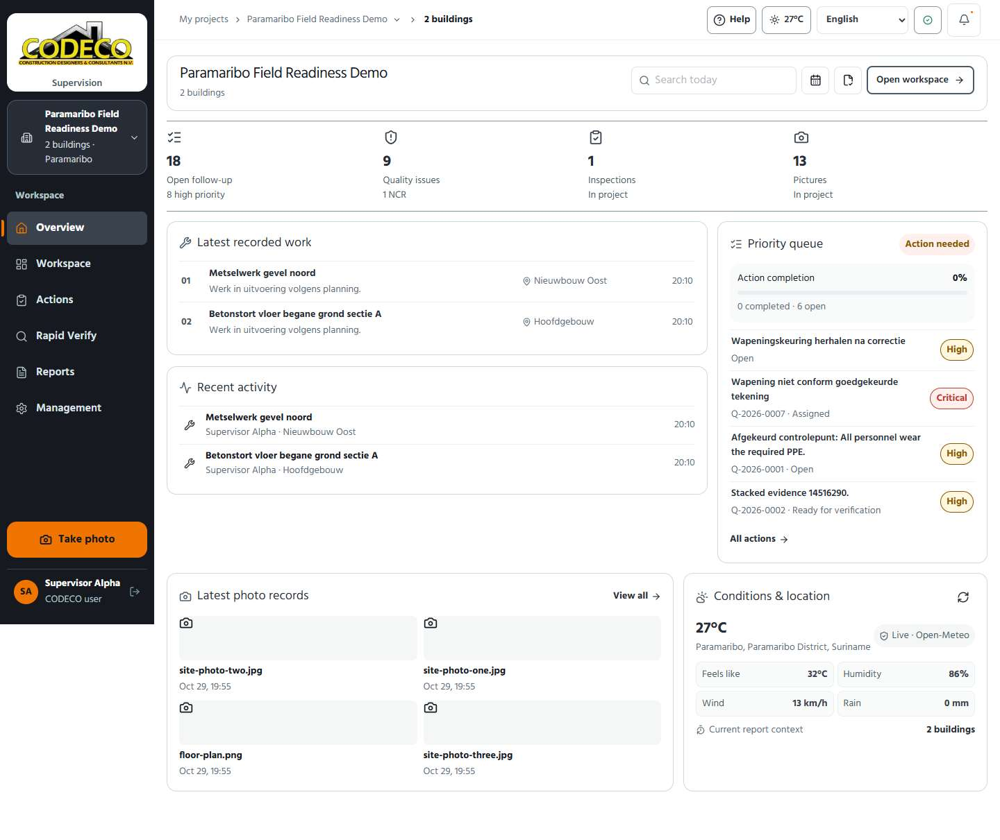
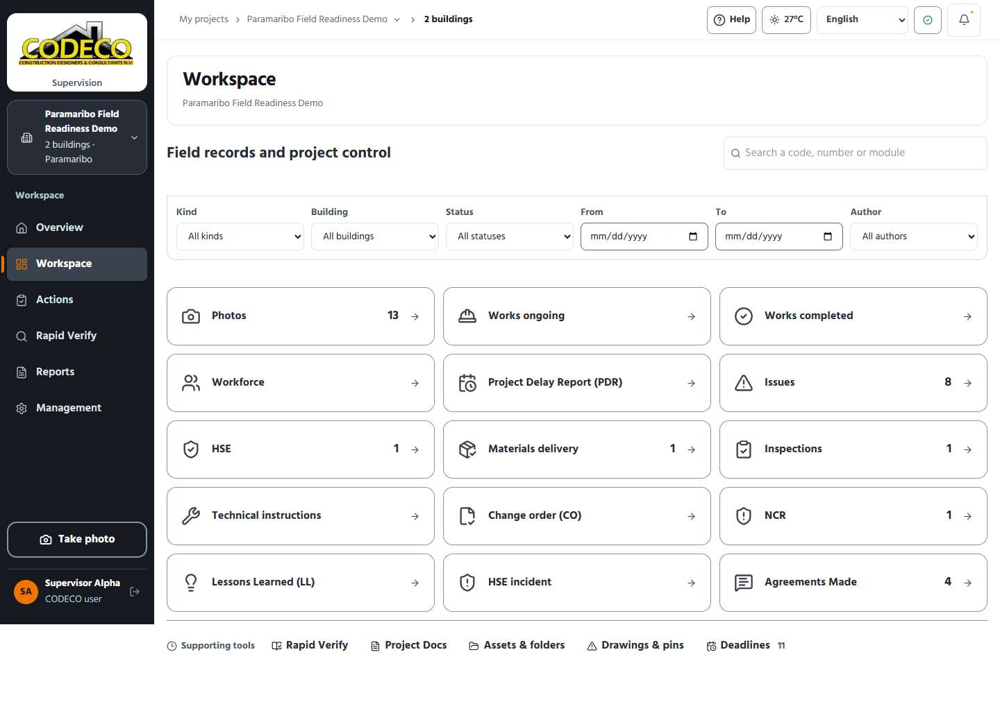

# UI audit: stability, touch targets and the calm palette, 29 October 2026

Run on the local stack. Every module and 18 workspace destinations were walked at 390, 820 and 1440 px (72 screens) by
[`ui-stability-audit.spec.ts`](../../apps/web/tests/e2e/ui-stability-audit.spec.ts), which is now part of the suite.
For each screen it records sideways scrolling, text cut off by its own box, controls on top of each other, targets too
small for a thumb or pointer, fixed bars over the last control, and layout shift while the screen loads.

## Colours

An earlier pass this day tried a black and yellow brand layer; it was not liked and was removed. The palette is again that
of the first version of the app, which the client prefers: orange for the one primary action and the current selection,
green for ticks and for what is done, a dark sidebar, and the cool blue-grey neutrals. What it keeps from the later
versions is the contrast (every text pair is 4.5:1 or better, field outlines 3:1), the 14 px minimum text and the touch
sizes. The roles are in `app/styles/brand.css` and the values in `app/styles/tokens.css`.

## What was unstable, and what fixed it

| Finding | Cause | Fix |
|---|---|---|
| The sign-in and loading card jumped by about 60 px on every load. | The logo declared a 738×291 ratio but the file is 2651×1248, so the box changed height when the image arrived. The loading card also grew as steps were added, and its language row wrapped or not depending on the font. | Real image size on all five uses; the card has its final height from the first frame; logo above and language below, always; the growing step list is last. |
| The Overview moved down by up to 0.11 when its data arrived. | Panels had no height until they were filled. | Minimum heights for the work, activity, photo and weather panels. |
| Folder buttons in Assets sat on top of each other. | The folder rows could shrink and clip their own buttons. | They keep their size and the row scrolls. |
| 1 100+ controls were under 44 px on phone and tablet. | Buttons, chips, selects, links and the workforce counters used 32–42 px. | One 48 px floor up to 1024 px for everything pressable except pins, markers and colour swatches; counters, source rows and drawing pager follow. |
| The save bar of a form was 4 px wider than its form on a phone. | A negative margin sized for the desktop padding. | Margin follows the phone padding. |
| Every record with photos exposed an identical region landmark. | `section` with a label. | A labelled group. |
| The Overview left a large empty box beside the priority queue. | Both columns stretched to equal height. | Recent activity moved under the latest work; the columns end together. |
| A photo code wrapped inside its card. | No `nowrap`. | Added. |

## Result

| | Before | After |
|---|---:|---:|
| Findings over 72 screens | 1 132 | 0 |
| Worst layout shift while loading (good is under 0.1) | 0.154 | 0.016 |
| Screens shifting more than 0.02 | 49 | 0 |

## Not covered

- Photo thumbnails read "Image unavailable" in the screenshots: this audit ran without a Blob store.
  The photo layouts were checked by the specs that do run against the fake store.
- Not looked at on a real phone in daylight, and not with a screen reader.
- The public landing site and the PDF reports were not changed.
