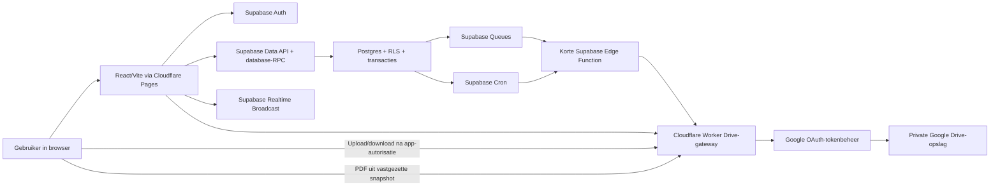

# Productplan – compleet online constructiesupervisieplatform

> **Actueel klantbesluit — 19-07-2026:** private Vercel Blob vervangt Google Drive en de Cloudflare Worker-gateway voor alle nieuwe bestandsopslag. De historische Drive/Cloudflare-secties hieronder blijven staan als oorspronkelijke productspecificatie; de uitvoeringsstatus en afwijking staan in `docs/product/product-plan-compliance.md`.

## 1. Productvisie

De applicatie wordt het centrale online werksysteem voor het volledige proces van een constructiesupervisiebedrijf. Het dagrapport is één belangrijke output, maar de gebruiker voert ook inspecties, kwaliteitsopvolging, HSE, documentcontrole, communicatie, planning, acties, goedkeuringen en projectsturing in dezelfde applicatie uit.

De gebruiker legt een waarneming één keer vast op het moment dat die ontstaat. De applicatie hergebruikt die informatie vervolgens automatisch in:

- het dagrapport;
- kwaliteits- en veiligheidsregisters;
- openstaande actiepunten;
- projectdashboards en voortgangsanalyses;
- meldingen en herinneringen;
- een juridisch traceerbare projecthistorie.

Het ideale resultaat is dat een supervisor gedurende de dag korte registraties doet en aan het einde van de dag alleen nog controleert, aanvult en ondertekent. Het rapport zelf wordt automatisch samengesteld.

### Hoofddoelen

1. Minder administratietijd en dubbel werk.
2. Consistente, volledige en professionele rapporten.
3. Snellere opvolging van afwijkingen, risico's en afspraken.
4. Betere bewijsvoering door tijdstempels, foto's, locaties en een audit trail.
5. Realtime inzicht voor projectleiding en opdrachtgever.
6. Eenvoudige aanpasbaarheid zonder telkens softwareontwikkeling nodig te hebben.
7. Eén centrale informatiebron voor alle operationele supervisiewerkzaamheden.

### Productprincipes

- **Mobile-first:** bruikbaar op telefoon en tablet, ook met handschoenen en in fel zonlicht.
- **Online-first:** Supabase/Postgres is altijd de centrale en actuele informatiebron; er komt geen aparte lokale database of synchronisatie-engine.
- **Eenmaal invoeren, overal hergebruiken:** geen dubbele invoer tussen modules.
- **Snelle invoer:** veelgebruikte registraties binnen enkele tikken.
- **Regelgestuurde automatisering:** automatische handelingen volgen zichtbare, configureerbare bedrijfsregels; kritieke feiten en juridische verklaringen worden door een mens bevestigd.
- **Configureerbaar:** formulieren, checklists, categorieën, nummering, rapportindeling en meldingen zijn door een beheerder aanpasbaar.
- **Traceerbaar:** wijzigingen, goedkeuringen, verzending en versies blijven aantoonbaar.
- **Reuse-first UI:** gebruik bestaande, onderhouden open-sourcecomponenten voor tabellen, datumvelden, bomen, dialogen, formulieren, uploads en grafieken; bouw alleen zelf wat echt projectspecifiek is.
- **Free-tier bewust:** ontwikkeling en eerste pilot blijven binnen gratis limieten, met ingebouwde gebruiksmeters en een migratiepad vóór een harde limiet wordt bereikt.

### Functionele productgrens

Binnen de applicatie moet het volledige supervisieproces kunnen worden uitgevoerd: projectinrichting, dagregistratie, inspecties, ITP's, kwaliteit/NCR, HSE, voortgang, tekeningen en documenten, RFI's, submittals, site instructions, materiaal en materieel, testen, vergaderingen, correspondentie, risico's, wijzigingen, acties, goedkeuringen, rapportage en dashboards.

De applicatie hoeft geen algemeen boekhoud-, salaris- of inkoopsysteem te worden. Waar nodig worden die systemen gekoppeld. Zo blijft het platform gespecialiseerd en snel, zonder functies van ERP- of planningsproducten onnodig na te bouwen.

## 2. Gebruikers en rechten

| Rol | Hoofdtaak | Belangrijkste rechten |
|---|---|---|
| Supervisor / inspecteur | Dagelijkse registratie en controle | Registreren, foto's maken, inspecties uitvoeren, bevindingen maken, rapport indienen en eventueel ondertekenen |
| Lead supervisor | Kwaliteitscontrole | Rapporten reviewen, terugsturen, goedkeuren, bevindingen verifiëren |
| Uitvoerder / aannemer | Acties uitvoeren | Toegewezen acties bekijken, bewijs uploaden, herstel gereedmelden, rapport medeondertekenen |
| Projectleider | Sturen op voortgang en risico | Alle projectdata bekijken, prioriteiten en deadlines wijzigen, rapporten goedkeuren |
| Opdrachtgever | Inzicht en formele ontvangst | Goedgekeurde rapporten en dashboards bekijken, optioneel ondertekenen of reageren |
| HSE- of kwaliteitsmanager | Specialistische opvolging | Veiligheids- of kwaliteitsregister beheren, trends en audits bekijken |
| Organisatiebeheerder | Applicatie configureren | Gebruikers, rollen, sjablonen, velden, nummering, branding, meldingen en bewaartermijnen beheren |
| Externe gast | Beperkte samenwerking | Alleen expliciet gedeelde rapporten, acties of documenten bekijken/bewerken |

Rechten moeten instelbaar zijn per organisatie, project, module en handeling. Een opdrachtgever hoeft bijvoorbeeld geen interne conceptnotities te zien en een aannemer mag geen oorspronkelijke inspectiewaarneming wijzigen.

## 3. Gewenste dagelijkse workflow

### A. Eenmalige projectinrichting

Een beheerder of projectleider maakt het project aan en configureert:

- projectgegevens, projectnummer, locatie en tijdzone;
- opdrachtgever, aannemers en onderaannemers;
- één of meer gebouwen per project, met daaronder zones, verdiepingen, ruimten/elementen en werkpakketten;
- gebruikers, rollen en distributielijsten;
- rapportnummering en gewenste PDF-indeling;
- inspectie- en veiligheidschecklists;
- tekeningen, normen en referentiedocumenten;
- standaard werktijden, eenheden en talen;
- projectplanning of mijlpalen;
- goedkeurings- en ondertekenworkflow.

Daarna maakt het systeem automatisch de basisregisters en projectsjablonen aan.

### B. Start van de werkdag

1. De supervisor opent **Vandaag**.
2. Datum, project, supervisor, rapportnummer, standaard werktijden en openstaande acties zijn al ingevuld.
3. Datum en tijd zijn automatisch ingevuld; de supervisor registreert het lokale weer via een compact standaardformulier.
4. Het systeem toont een korte startcheck: geplande werkzaamheden, open kritieke bevindingen, inspecties die vandaag moeten plaatsvinden en verwachte risico's.
5. De gebruiker start het dagrapport met één actie.

### C. Registratie gedurende de dag

Vanaf ieder scherm is een vaste knop **Snel toevoegen** beschikbaar voor:

- foto;
- bevinding / afwijking;
- activiteit of voortgang;
- inspectie;
- HSE-observatie of incident;
- actiepunt;
- levering;
- test of meting;
- vertraging;
- afspraak of notitie.

Locatie, tijd, gebruiker, project en waar toegestaan GPS worden automatisch toegevoegd. De gebruiker vult alleen de inhoud in die niet betrouwbaar kan worden afgeleid.

### D. Einde van de werkdag

1. De applicatie verzamelt alle registraties van die dag.
2. Een controlescherm toont ontbrekende verplichte informatie, tegenstrijdigheden en registraties zonder classificatie.
3. Het systeem bouwt met vaste tekstsjablonen een dagsamenvatting en lijst voor morgen uit de bevestigde registraties.
4. De supervisor controleert en corrigeert deze tekst.
5. De gebruiker bekijkt de PDF-preview en dient het rapport in.
6. Afhankelijk van de workflow volgt review, ondertekening en automatische distributie.
7. Open acties, afwijkingen en risico's worden meegenomen naar de volgende dag; afgesloten onderwerpen blijven in de historie.

### E. Opvolging na rapportage

- Verantwoordelijken krijgen een taak met deadline en context.
- Herinneringen en escalaties worden automatisch verstuurd.
- Herstelbewijs wordt aan de oorspronkelijke bevinding gekoppeld.
- Een bevoegde supervisor verifieert de oplossing voordat een afwijking definitief sluit.
- Managementdashboards worden direct bijgewerkt.

## 4. Functionele modules

### 4.1 Organisatie-, project- en referentiebeheer

**Functionaliteit**

- meerdere organisaties en projecten ondersteunen;
- projectstatus, projectteam en contactpersonen;
- vaste locatiehiërarchie: project > gebouw > zone/verdieping > ruimte/element;
- werkpakketten, disciplines, fasen en activiteiten;
- documentregister voor tekeningen, normen en specificaties;
- versiebeheer van referentiedocumenten;
- projectkalender, werktijden en feestdagen;
- import van stamgegevens via spreadsheet;
- archivering van afgeronde projecten.

**Automatisering**

- projectgegevens automatisch invullen in iedere registratie;
- standaardteams, checklists en rapportinstellingen kopiëren vanuit een projectsjabloon;
- gebruikers uitnodigen op basis van rol;
- waarschuwen als een verouderde tekening wordt geselecteerd.

### 4.2 Dagrapportmotor

Dit is de samenstellende laag, niet de primaire invoerlaag.

**Functionaliteit**

- automatisch uniek rapportnummer;
- concept, in review, goedgekeurd, ondertekend, verzonden en gereviseerd als statussen;
- modules in- of uitschakelen per project;
- automatische inhoudsopgave en paginanummering;
- PDF-preview voordat het rapport definitief wordt;
- aangepaste huisstijl, logo, kop- en voettekst;
- taalkeuze per rapport;
- revisies zonder de oorspronkelijke versie te overschrijven;
- distributielijst en verzendhistorie;
- export naar PDF en eventueel spreadsheet/gegevensbestand.

**Automatisering**

- alle registraties van de geselecteerde dag en dienst ophalen;
- KPI's en tabellen berekenen;
- foto-overzichten en bijlagen genereren;
- openstaande onderwerpen automatisch opnemen;
- dagsamenvatting opbouwen met vaste tekstsjablonen en feitelijke registraties;
- volledigheidscontrole vóór indiening;
- na goedkeuring PDF vastzetten en distribueren.

### 4.3 Aanwezige partijen en mankracht

**Functionaliteit**

- organisatie, ploeg, discipline en aantal personen;
- werktijd of dienst;
- bezoekersregistratie;
- optioneel individuele aanwezigheidsregistratie;
- toelichting bij afwijkende bezetting.

**Automatisering**

- vorige werkdag als voorstel kopiëren;
- totalen per organisatie en discipline berekenen;
- grote afwijkingen ten opzichte van planning of vorige dagen signaleren;
- optioneel importeren uit toegangscontrole of presentielijst.

### 4.4 Activiteiten en voortgang

**Functionaliteit**

- activiteit, werkpakket, locatie, aannemer en periode;
- hoeveelheid met eenheid en/of percentage gereed;
- status: niet gestart, actief, geblokkeerd, gereed;
- foto's, opmerkingen en bewijsstukken;
- koppeling met planning/mijlpaal;
- vastleggen van productie per dag.

**Automatisering**

- voortgang van gisteren tonen en alleen de wijziging laten invoeren;
- voortgang nooit onbedoeld laten dalen zonder motivatie;
- project- en weekvoortgang berekenen;
- vertraging of blokkade automatisch als risico voorstellen;
- gereedmelding koppelen aan vereiste inspectie of test.

### 4.5 Inspecties en configureerbare checklists

**Functionaliteit**

- inspectietype kiezen uit sjabloon;
- controlepunten met ja/nee/n.v.t., akkoord/niet akkoord of meetwaarde;
- opmerkingen, foto's, schetsen en markeringen;
- koppeling met locatie, element, tekening, norm en specificatie;
- handtekening of akkoord van betrokken partij;
- herinspectie;
- terugkerende en geplande inspecties.

**Automatisering**

- relevante checklist voorstellen op basis van activiteit/fase;
- automatisch een bevinding aanmaken bij een afgekeurd controlepunt;
- grenswaarden controleren bij meetwaarden;
- herinspectie plannen na gereedmelding van herstel;
- inspectienummer en certificaat/PDF genereren.

### 4.6 Kwaliteitsbevindingen, afwijkingen en NCR's

**Functionaliteit**

- type: observatie, tekortkoming, afwijking, NCR, kans op verbetering;
- ernst, prioriteit en impact;
- locatie, discipline, werkpakket en verantwoordelijke partij;
- omschrijving, oorzaak, norm, tekening en specificatie;
- foto vóór herstel en foto/bewijs na herstel;
- deadline, voorgestelde correctie en definitieve maatregel;
- review en verificatie door bevoegde gebruiker;
- volledig communicatie- en statusverloop.

**Voorgestelde statusflow**

`Concept → Open → Toegewezen → In uitvoering → Gereed voor verificatie → Gesloten`

Daarnaast: `Afgewezen`, `Heropend`, `Geannuleerd` met verplichte reden.

**Automatisering**

- uniek nummer zoals Q-2026-001;
- verantwoordelijke voorstellen op basis van discipline/locatie;
- deadline voorstellen op basis van ernst;
- kritieke afwijkingen direct escaleren;
- herinneringen sturen vóór en na deadline;
- soortgelijke of mogelijk dubbele bevindingen tonen;
- een bevinding pas sluiten na vereiste verificatie.

### 4.7 Veiligheid en HSE

**Functionaliteit**

- dagelijkse veiligheidschecklist;
- positieve observatie, onveilige handeling en onveilige situatie;
- incident, near miss en stop-work registratie;
- PBM, steiger, valbeveiliging, elektriciteit, brandveiligheid en vergunningen;
- toolboxmeeting met onderwerp en aanwezigen;
- letsel, ernst, directe maatregel en vervolgonderzoek;
- vertrouwelijkheid voor gevoelige incidentinformatie.

**Automatisering**

- afwijkend HSE-antwoord omzetten naar actie of incident;
- ernstige gebeurtenissen onmiddellijk melden aan ingestelde rollen;
- locatie en tijd vastleggen;
- terugkerende controles plannen;
- HSE-statistieken en trendwaarschuwingen bijwerken.

### 4.8 Materieel

**Functionaliteit**

- machine/type, eigenaar en identificatienummer;
- operationeel, in gebruik, defect, buiten gebruik;
- draaiuren of inzetperiode;
- keuring/certificaat en vervaldatum;
- storing, stilstand en opmerkingen.

**Automatisering**

- aanwezige machines uit vorige dag voorstellen;
- verlopen of bijna verlopen certificaten signaleren;
- defect materieel koppelen aan vertraging of actie;
- inzet- en uitvalstatistieken berekenen.

### 4.9 Materiaalleveringen

**Functionaliteit**

- materiaal, hoeveelheid, eenheid, leverancier en tijd;
- bestelbon, leveringsbon, batch- of lotnummer;
- ontvangen, deels ontvangen, geweigerd of in quarantaine;
- visuele ontvangstcontrole;
- certificaten en foto's;
- opslaglocatie.

**Automatisering**

- leveringsbon registreren via een snel, gestructureerd invoerformulier;
- hoeveelheid en eenheid valideren;
- ontbreken van vereist certificaat signaleren;
- geweigerde levering automatisch als bevinding/actie voorstellen;
- leveringsbon aan rapport en materiaalregister koppelen.

### 4.10 Testen en metingen

**Functionaliteit**

- configureerbare testtypes zoals slump, cube, betondekking, dichtheid, lasinspectie en total station;
- meetwaarden, eenheden, methode en gebruikte apparatuur;
- grenswaarden en toleranties;
- uitvoerder/laboratorium, monster- of testnummer;
- kalibratiegegevens van meetapparatuur;
- certificaat, foto en bijlage;
- voorlopig en definitief resultaat.

**Automatisering**

- automatische akkoord/afkeur op basis van configureerbare grenswaarden;
- afwijkend resultaat omzetten in bevinding;
- ontbrekend definitief laboratoriumresultaat als opvolgactie bewaken;
- trends per locatie, materiaal, leverancier en periode tonen.

### 4.11 Meer- en minderwerk

**Functionaliteit**

- omschrijving, aanleiding, partij en locatie;
- inschatting van tijd- en kostenimpact;
- bewijs: foto, instructie, tekening of communicatie;
- status, besluit en goedkeurder;
- koppeling met dagelijks uitgevoerde extra werkzaamheden.

**Automatisering**

- uniek wijzigingsnummer;
- ontbrekend formeel besluit signaleren;
- dagelijkse observaties bundelen in een wijzigingsdossier;
- impact op planning/risico tonen zonder automatisch financiële besluiten te nemen.

### 4.12 Vertragingen en belemmeringen

**Functionaliteit**

- oorzaak, begin/einde, duur en getroffen activiteit;
- verantwoordelijkheid/categorie;
- aantal getroffen personen en materieel;
- bewijs en genomen maatregel;
- mogelijke tijd- en kostenimpact.

**Automatisering**

- duur berekenen uit tijdstippen;
- overlap detecteren zodat uren niet dubbel worden geteld;
- slecht weer koppelen aan vastgelegde weerdata;
- terugkerende oorzaken en cumulatieve impact tonen;
- actieve blokkades automatisch bij risico's en planning morgen tonen.

### 4.13 Communicatie en afspraken

**Functionaliteit**

- gesprek, vergadering, instructie, verzoek om informatie of besluit;
- aanwezigen, onderwerp en gemaakte afspraak;
- verantwoordelijke en deadline;
- foto, document of referentie;
- bevestiging door betrokkenen.

**Automatisering**

- afspraak met verantwoordelijke en deadline omzetten naar actiepunt;
- open afspraak meenemen naar volgende rapporten;
- herinnering versturen en ontvangst registreren;
- later koppelen aan e-mail of samenwerkingsplatformen.

### 4.14 Actiepunten

**Functionaliteit**

- actie kan zelfstandig bestaan of ontstaan uit inspectie, bevinding, incident, risico, communicatie of test;
- verantwoordelijke persoon én organisatie;
- deadline, prioriteit, status en bewijs;
- reacties, @mentions en activiteitshistorie;
- bulktoewijzing en filters;
- verificatie indien vereist.

**Automatisering**

- dagelijkse persoonlijke takenlijst;
- herinnering en escalatie volgens configureerbare regels;
- verlopen acties automatisch markeren;
- open acties meenemen naar het volgende relevante dagrapport;
- sluiting van bronrecord blokkeren zolang verplichte acties openstaan.

### 4.15 Risico's en planning morgen

**Functionaliteit**

- risico, kans, impact, eigenaar en beheersmaatregel;
- geplande activiteiten voor volgende dag of dienst;
- benodigde inspecties, mensen, materiaal en materieel;
- afhankelijkheden en verwachte knelpunten.

**Automatisering**

- open blokkades, kritieke acties en late leveringen als risico voorstellen;
- onafgeronde activiteiten als voorstel meenemen;
- benodigde checklist of inspectie klaarzetten;
- de volgende ochtend een gerichte startbriefing tonen.

### 4.16 Foto's, annotaties en bijlagen

**Functionaliteit**

- camera en galerij-upload;
- meerdere foto's achter elkaar maken;
- categorie, locatie, richting en omschrijving;
- tekenen, pijlen, cirkels en tekst op een kopie van de foto;
- originele foto altijd bewaren;
- bijlagen zoals betonbonnen, certificaten, tekeningen en meetrapporten;
- zoeken en filteren in fotoregister;
- foto koppelen aan meerdere gerelateerde records zonder duplicaatbestand.

**Automatisering**

- tijd, gebruiker en beschikbare GPS automatisch vastleggen;
- locatie voorstellen op basis van laatst gebruikte zone of QR-code;
- categorie voorstellen vanuit het scherm waar de camera is geopend;
- fotonummering en compressie uitvoeren zonder het origineel te verliezen;
- upload op de achtergrond hervatten zodra er verbinding is;
- onscherpe of zeer donkere foto's signaleren;
- documenttype, documentdatum en eventuele vervaldatum voorstellen.

### 4.17 Review, digitale handtekening en distributie

**Functionaliteit**

- rapport volledig controleren vóór indiening;
- reviewcommentaar per rapportsectie of registratie;
- goedkeuren, terugsturen of gemotiveerd afwijzen;
- ondertekenen door supervisor, uitvoerder en optioneel opdrachtgever;
- volgorde van beoordelaars/ondertekenaars configureren;
- PDF-preview, revisienummer en definitieve rapportstatus;
- distributielijst en aantoonbare verzendhistorie;
- ontvangstbevestiging indien het contract dat vereist.

**Automatisering**

- herinnering sturen bij openstaande review;
- ondertekende versie vergrendelen;
- correcties als nieuwe revisie laten verlopen;
- goedgekeurde versie automatisch distribueren en archiveren.

De vereiste juridische sterkte van een digitale handtekening moet tijdens discovery per land, contracttype en klant worden bepaald. Een getekende afbeelding alleen is niet in elke situatie voldoende.

### 4.18 Documenten, tekeningen en revisiebeheer

**Functionaliteit**

- centraal document- en tekeningenregister;
- documentnummer, discipline, type, status, revisie en geldigheidsdatum;
- werkstromen voor indienen, controleren, becommentariëren, goedkeuren en afwijzen;
- markeringen en opmerkingen op tekeningen zonder het bronbestand te wijzigen;
- transmittals en distributielijsten;
- koppeling vanuit inspectie, bevinding, activiteit, RFI en rapport;
- volledige revisiehistorie en zichtbare actuele/geldige versie;
- beperkte toegang voor aannemer, adviseur en opdrachtgever.

**Automatisering**

- gebruikers waarschuwen wanneer een gekoppelde tekening is vervangen;
- verouderde revisies duidelijk blokkeren voor nieuwe registraties;
- open documentreviews bewaken en escaleren;
- documentmetadata en revisie uit het indieningsformulier overnemen;
- iedere rapportverwijzing vastzetten op de exacte gebruikte documentversie.

### 4.19 RFI's, submittals en site instructions

**Functionaliteit**

- aparte, configureerbare workflows voor Request for Information, materiaal-/shopdrawing-submittals en formele site instructions;
- uniek nummer, discipline, locatie, onderwerp, verantwoordelijke, deadline en contractuele impact;
- vragen, antwoorden, bijlagen, tekeningen en beslissingen in één tijdlijn;
- review door meerdere disciplines;
- status, responstermijn en formele afsluiting;
- koppeling met wijziging, risico, actie, inspectie en dagrapport.

**Automatisering**

- nummering en responstermijn berekenen;
- herinnering en escalatie vóór overschrijding;
- antwoord of instructie automatisch bij gerelateerde activiteiten tonen;
- mogelijke tijd-/kostenimpact ter beoordeling doorzetten naar het wijzigingsregister;
- open RFI's en submittals in projectdashboard en dagstart tonen.

### 4.20 Vergaderingen, correspondentie en besluiten

**Functionaliteit**

- vergadering plannen en deelnemers vastleggen;
- agenda, notulen, besluiten en acties;
- formele inkomende en uitgaande correspondentie;
- onderwerpen koppelen aan projectrecords;
- review en vrijgave van notulen;
- zoeken op afzender, onderwerp, datum, discipline en projectlocatie.

**Automatisering**

- actiepunten rechtstreeks uit notulen aanmaken;
- openstaande punten meenemen naar de volgende vergadering;
- notulen ter review en vervolgens naar de distributielijst sturen;
- besluiten zichtbaar maken op alle gerelateerde records;
- een vaste notulenopbouw genereren uit agenda, besluiten en bevestigde acties.

### 4.21 Back-up, export en herstel

**Functionaliteit**

- dagelijks automatisch een JSON-back-up maken;
- handmatige back-up door een bevoegde beheerder;
- back-ups per organisatie, project of volledige applicatie;
- back-upbestand opslaan in een afgeschermde Google Drive-map die uitsluitend door de applicatie wordt beheerd;
- lijst met datum, omvang, inhoud, status, checksum en maker;
- back-up als gecomprimeerd JSON-bestand downloaden;
- herstel eerst als dry run uitvoeren met aantallen, waarschuwingen en conflicten;
- volledig project herstellen naar een leeg project of gecontroleerd terugzetten;
- vóór een herstelactie automatisch een nieuwe veiligheidsback-up maken;
- iedere back-up- en herstelactie opnemen in de audittrail.

**Inhoud van een back-up**

- `schema_version`, applicatieversie, datum/tijd en tijdzone;
- organisatie-, project- en gebouwgegevens;
- gebruikersreferenties, memberships, rollen en rechten zonder wachtwoorden/tokens;
- sjablonen, formulieren, checklists en instellingen;
- dagrapporten, inspecties, bevindingen, acties, HSE en overige procesdata;
- rapportversies en handtekening-/goedkeuringsmetadata;
- bestandsmanifest met Google Drive file-ID, parent-folder-ID, type, omvang en SHA-256-checksum;
- recordaantallen en manifest-checksum.

**Retentie op de gratis startarchitectuur**

- 7 dagelijkse back-ups;
- 4 wekelijkse back-ups;
- 3 maandelijkse back-ups;
- handmatig gemarkeerde back-ups worden niet automatisch geroteerd;
- rotatie verwijdert alleen oude back-upbestanden, nooit primaire projectrecords.

De JSON-back-up bevat een manifest van foto's en documenten, maar niet automatisch een tweede kopie van alle binaire bestanden. Omdat primaire bestanden en back-ups in hetzelfde Google-account staan, beschermt dit tegen databasefouten en foutieve wijzigingen, maar niet volledig tegen verlies of blokkering van dat Google-account. De beheerder kan daarom iedere back-up en ieder projectdossier handmatig downloaden.

## 5. Schermen en navigatie

### 5.1 Hoofdnavigatie en vaste instroom

De gebruiker komt altijd via deze hiërarchie in het operationele werk:

1. **Mijn projecten** – kies het project.
2. **Gebouwen** – kies het gebouw binnen dat project.
3. **Projectstart** – open de dagelijkse cockpit in de context van dat project en gebouw.

De geselecteerde context blijft zichtbaar in de kop van ieder scherm en kan daar worden gewijzigd. Projectbrede schermen, zoals het dagrapport, rapporthistorie en managementdashboard, combineren de gegevens uit alle gebouwen. Registraties die fysiek werk betreffen, zoals activiteiten, inspecties, foto's, bevindingen en leveringen, krijgen verplicht een gebouw toegewezen.

Onderste navigatie met maximaal vijf primaire keuzes nadat project en gebouw zijn gekozen:

Onderste navigatie met maximaal vijf primaire keuzes:

1. **Vandaag** – dagoverzicht en rapportstatus.
2. **Project** – activiteiten, registers en documenten.
3. **Snel toevoegen** – centrale actieknop.
4. **Acties** – eigen en toegewezen opvolging.
5. **Meer** – rapporten, dashboards, instellingen en profiel.

Op desktop kan dezelfde structuur een zijmenu worden.

### 5.2 Schermenoverzicht

| Scherm | Belangrijkste inhoud en acties |
| --- | --- |
| Inloggen / toegang | Veilige login, uitnodiging accepteren, eventueel extra verificatie |
| Mijn projecten | Zoek/filter, favorieten, laatste activiteit, kritieke meldingen |
| Gebouwen | Gebouwen van het gekozen project, status, voortgang, open bevindingen en gebouw kiezen |
| Projectstart | Vandaag starten binnen het gekozen gebouw, project-KPI's, open escalaties en recente rapporten |
| Vandaag / dagcockpit | Rapportstatus, tijdlijn, volledigheid, dags-KPI's, snelle modules |
| Snel toevoegen | Grote keuzetegels, camera direct beschikbaar, laatst gebruikte locatie onthouden |
| Activiteit en voortgang | Planninglijst, werkelijke voortgang, blokkades, foto's |
| Inspectielijst | Gepland, uitgevoerd, resultaat, herinspecties, nieuwe inspectie |
| Inspectie uitvoeren | Checklist per sectie, metingen, foto's, afwijking direct aanmaken |
| Bevindingenregister | Filter op ernst/status/locatie/verantwoordelijke, kaart- of lijstweergave |
| Bevindingdetail | Bewijs, tekening/norm, tijdlijn, toewijzing, herstel, verificatie |
| HSE | Dagcheck, observaties, incident/near miss, directe escalatie |
| Aanwezigheid | Partijen/ploegen, aantallen, werktijden, kopiëren van vorige dag |
| Materieel | Aanwezig materieel, statuswijziging, keuringen en storing |
| Leveringen | Ontvangst, hoeveelheid, bon/certificaat scannen, schade/afkeur |
| Testen en metingen | Templates, meetwaarden, pass/fail, open laboratoriumresultaten |
| Vertraging | Tijdblok, oorzaak, activiteit, bewijs en berekende duur |
| Communicatie | Gesprekken, deelnemers, afspraken en acties |
| Actiebord | Mijn acties, projectacties, deadlines, status en escalaties |
| Risico's / morgen | Risico's, planning morgen, voorstellen vanuit open zaken |
| Fotoregister | Galerij, filters, annoteren, koppelingen en fotovergelijking |
| Documenten en tekeningen | Register, actuele revisie, viewer, markeringen, review en transmittals |
| RFI-register en detail | Vragen, antwoorden, responstermijnen, impact en formele afsluiting |
| Submittals | Materiaal-/documentindiening, multidisciplinaire review en besluit |
| Site instructions | Formele instructie, ontvangst, impact, uitvoering en bewijs |
| Vergaderingen en notulen | Agenda, deelnemers, besluiten, acties, review en distributie |
| Correspondentie | Inkomend/uitgaand register, relaties, bijlagen en formele status |
| Rapportcontrole | Sectienavigatie, waarschuwingen, voorgestelde samenvatting, preview |
| Review en ondertekening | Reviewcommentaren, goedkeuren/terugsturen, ondertekenen |
| Rapporthistorie | Rapporten, revisies, ondertekenstatus, downloads en verzendlog |
| Projectdashboard | KPI's, trends en doorklik naar brongegevens |
| Beheerportaal | Projecten, gebruikers, rollen, sjablonen, regels en huisstijl |
| Back-up en herstel | Gebruik, back-uphistorie, handmatig exporteren, downloaden, dry run en gecontroleerd herstellen |
| Externe taakpagina | Aannemer ziet alleen toegewezen taak, deadline, reactie en uploadmogelijkheid |

### 5.3 Dagcockpit als belangrijkste scherm

De dagcockpit moet de gebruiker binnen enkele seconden antwoord geven op:

- wat staat vandaag gepland;
- wat moet ik nog controleren;
- welke kritieke problemen zijn open;
- welke informatie ontbreekt nog voor het rapport;
- wat is sinds mijn laatste bezoek gewijzigd;
- kan het rapport worden afgerond?

Aanbevolen opbouw:

1. project, datum/dienst, weer en rapportstatus;
2. grote knop **Snel toevoegen**;
3. waarschuwingen en ontbrekende verplichte gegevens;
4. tijdlijn van registraties;
5. compacte moduolkaarten met aantallen en status;
6. onderaan **Rapport controleren**.

## 6. Automatiseringsplan

### 6.1 Direct in de eerste versie automatiseren

| Trigger | Automatische actie | Menselijke controle |
| --- | --- | --- |
| Nieuwe werkdag | Conceptdagrapport met nummer en basisgegevens maken | Supervisor bevestigt dienst en werktijden |
| Rapport gestart | Open acties, risico's en geplande inspecties ophalen | Gebruiker bepaalt relevantie voor vandaag |
| Foto gemaakt | Tijd, maker, project en beschikbare locatie vastleggen | Locatie/categorie en omschrijving bevestigen |
| Inspectiepunt niet akkoord | Conceptbevinding maken | Ernst, verantwoordelijke en deadline bevestigen |
| Meetwaarde buiten tolerantie | Waarschuwing en conceptbevinding | Bevoegde gebruiker beoordeelt context |
| Bevinding toegewezen | Taak en melding aan verantwoordelijke | Ontvanger reageert of accepteert volgens projectregel |
| Deadline nadert/verloopt | Herinneren en eventueel escaleren | Projectleider kan deadline gemotiveerd wijzigen |
| Dag afsluiten | Compleetheidscontrole en rapportpreview | Supervisor corrigeert en geeft vrij |
| Rapport goedgekeurd | PDF en archiefversie genereren | Ondertekenaar bevestigt indien vereist |
| Rapport verzonden | Verzendlog en ontvangerstoegang vastleggen | Beheerder behandelt mislukte bezorging |
| Open zaak aan volgende dag | Zichtbaar maken in dagcockpit | Supervisor bepaalt dagrelevantie, zaak blijft projectbreed open |

### 6.2 Verdere regelgestuurde automatisering

- dagsamenvatting genereren met vaste tekstblokken en berekende aantallen;
- inspecties klaarzetten via een configureerbare activiteit-checklistmatrix;
- verantwoordelijke en standaarddeadline invullen vanuit discipline, ernst en projectregels;
- open punten op vaste wijze overnemen naar de volgende dag of vergadering;
- verlopen documenten, certificaten, acties en reviews volgens schema escaleren;
- dashboards en managementtotalen vooraf berekenen;
- rapporten na de vereiste goedkeuring automatisch genereren, distribueren en archiveren;
- dubbele verzending voorkomen met unieke sleutels en databasebeperkingen.

### 6.3 Grenzen aan automatisering

De applicatie mag niet autonoom:

- een veiligheidsincident verzwijgen of sluiten;
- een NCR, contractwijziging of meerwerk formeel goedkeuren;
- een herstel als geverifieerd markeren;
- een rapport namens een persoon ondertekenen;
- automatisch een contractuele aansprakelijkheid of juridische conclusie vaststellen.

Er komt geen AI, machine learning, OCR, spraakherkenning of generatieve tekstfunctie in het product. Iedere automatisering is herleidbaar tot een vaste bedrijfsregel, berekening, sjabloon of expliciete gebruikersactie en wordt waar relevant in de audittrail opgenomen.

## 7. Configureerbaarheid door de organisatie

Dit is een kernfunctie, geen beheer-extra. Een organisatiebeheerder moet via schermen kunnen instellen:

- dagrapportsecties, volgorde en zichtbaarheid;
- welke velden verplicht, optioneel of verborgen zijn;
- inspectie- en HSE-checklists;
- bevindingcategorieën, ernstmatrix, statusflow en standaarddeadlines;
- projectlocatiehiërarchie en disciplines;
- eenheden en meettoleranties;
- rapport- en objectnummering;
- PDF-huisstijl, kop-/voettekst en ondertekenblokken;
- review- en goedkeuringsroute per projecttype;
- rollen en rechten;
- notificatiemomenten en escalatieregels;
- distributielijsten;
- talen en standaardteksten;
- bewaartermijnen;
- welke modules per project actief zijn.

### Sjablonen en versiebeheer

- organisatiesjabloon → projectsjabloon → projectspecifieke aanpassing;
- wijzigingen aan een sjabloon krijgen een versienummer;
- bestaande, ondertekende rapporten blijven gekoppeld aan de oude versie;
- beheerder ziet vooraf welke projecten door een wijziging worden geraakt;
- sjablonen kunnen worden geëxporteerd, gekopieerd en getest voordat ze actief worden.

Een volledige vrije formulierbouwer is krachtig maar risicovol. Begin met configureerbare, vooraf gedefinieerde veldtypen en modules. Voeg pas later complexe logica toe, zoals conditionele secties en berekende velden.

## 8. Statussen en essentiële bedrijfsregels

### Rapport

`Concept → In uitvoering → Gereed voor review → Goedgekeurd → Ondertekend → Verzonden → Gearchiveerd`

- Een teruggestuurd rapport gaat terug naar **In uitvoering** met commentaar.
- Na ondertekening wordt inhoud niet overschreven.
- Een correctie resulteert in revisie R1, R2 enzovoort met reden en verwijzing naar de vorige versie.
- Een rapport kan pas gereed worden gemeld als alle projectgebonden verplichte controles slagen.

### Bevinding

- Iedere bevinding heeft één huidige eigenaar en een volledige historie.
- Alleen een bevoegde supervisor/reviewer kan een herstel verifiëren en sluiten.
- Bij heropening blijven vorige reacties en bewijs zichtbaar.
- Deadlines veranderen alleen met reden, gebruiker en tijdstip in de auditlog.
- Kritieke bevindingen kunnen een directe notificatie en werkstopprocedure activeren.

### Actie

- Een actie bevat minstens omschrijving, verantwoordelijke, deadline en bron.
- Sluiten vereist optioneel bewijs, afhankelijk van actietype.
- De bron kan een inspectie, bevinding, overleg, risico, levering of losstaande observatie zijn.

### Verwijderen

- Relevante projectregistraties worden bij voorkeur ingetrokken/geannuleerd in plaats van fysiek verwijderd.
- Reden en auditinformatie zijn verplicht.
- Definitief verwijderen is beperkt tot bevoegde beheerders en alleen waar contractuele en privacyregels dat toestaan.

## 9. Conceptueel gegevensmodel

De belangrijkste objecten en relaties zijn:

- **Organisatie** heeft gebruikers, rollen, sjablonen en projecten.
- **Project** heeft één of meer gebouwen, partijen, leden, documenten, rapporten en configuratie.
- **Gebouw** is de verplichte bovenliggende locatie voor fysieke registraties en bevat zones, verdiepingen, ruimten/elementen en werkpakketten.
- **Dagrapport** verzamelt verwijzingen naar registraties van een project, datum en dienst.
- **Activiteit** hoort bij een projectlocatie en kan voortgang, foto's, inspecties en vertragingen hebben.
- **Inspectie** gebruikt een versie van een checklist en kan bevindingen opleveren.
- **Bevinding/NCR** heeft bewijs, verantwoordelijke, acties, reacties en verificaties.
- **HSE-registratie** kan een incident, near miss, observatie of checklist zijn.
- **Actie** heeft een bronobject, eigenaar, deadline, status en bewijs.
- **Materieelregistratie**, **levering**, **test/meting**, **vertraging**, **communicatie**, **wijziging** en **risico** zijn zelfstandige objecten die aan rapport, locatie en andere objecten kunnen worden gekoppeld.
- **Media/bijlage** wordt één keer opgeslagen en kan meerdere koppelingen hebben.
- **Rapportversie** bewaart de exacte gerenderde inhoud, sjabloonversie, handtekeningen en distributiegegevens.
- **Auditgebeurtenis** legt relevante wijzigingen vast met actor, tijd, bron en oude/nieuwe waarde waar passend.

Belangrijk: vrije tekst in de PDF mag niet de enige bron zijn. De onderliggende gegevens moeten gestructureerd blijven om later te kunnen zoeken, filteren en analyseren.

## 10. Online-first gegevensverwerking en verbindingsgedrag

Supabase/Postgres is de enige centrale informatiebron. Er komt geen lokale projectdatabase, offline werkmodus of synchronisatie-engine. Daardoor zien gebruikers dezelfde actuele status en ontstaan geen complexe conflicten tussen lokale kopieën.

### Online gedrag

- iedere succesvolle mutatie wordt direct centraal opgeslagen;
- formulieren slaan kleine conceptwijzigingen automatisch op zolang verbinding beschikbaar is;
- de interface gebruikt optimistische updates wanneer een handeling veilig terug te draaien is;
- realtime gebeurtenissen verversen alleen de relevante schermgegevens;
- gelijktijdige wijzigingen worden bewaakt met een versienummer of `updated_at`-controle;
- kritieke statusovergangen, nummering en goedkeuringen gebeuren atomair in de database.

### Tijdelijke verbindingsproblemen

- de app toont onmiddellijk dat opslaan tijdelijk niet mogelijk is;
- de huidige, nog niet verzonden formulierinhoud blijft gedurende de geopende sessie in het scherm beschikbaar;
- de gebruiker kan na herstel van de verbinding opnieuw verzenden;
- schrijfopdrachten krijgen een idempotency key zodat opnieuw proberen geen dubbele bevinding, actie of rapportversie maakt;
- grote foto's en documenten gebruiken hervatbare uploads met zichtbare voortgang;
- formele acties zoals ondertekenen, goedkeuren en distribueren worden pas als voltooid getoond na bevestiging door de server.

De app doet dus niet alsof alles is opgeslagen wanneer er geen verbinding is. Betrouwbaarheid komt uit directe centrale bevestiging, idempotente verwerking en duidelijke statusfeedback.

## 11. Juridische traceerbaarheid, beveiliging en privacy

Minimale eisen:

- rol- en projectgebaseerde toegang;
- extra verificatie voor gevoelige rollen waar gewenst;
- versleutelde communicatie en opslag;
- audittrail voor wijzigingen, statussen, goedkeuringen, handtekeningen en verzendingen;
- exacte rapportversies bewaren;
- back-up en herstelprocedure;
- bewaartermijnen en legal hold;
- exporteerbaar projectdossier bij afronding;
- logging van beheerderstoegang;
- toestemming en transparantie rond GPS, foto's en persoonsgegevens;
- mogelijkheid om interne notities af te schermen voor externen;
- incidentgegevens desgewenst extra beperken;
- beleid voor data-export, verwijdering en overdracht.

Voor ingebruikname zijn een privacytoets, beveiligingstest en juridische beoordeling van ondertekening, bewaartermijnen en rapportstatus nodig voor de landen en contracten waarin de app wordt gebruikt.

## 12. Notificaties en gegevensuitvoer

### Notificaties

- in-app als primaire bron;
- e-mail voor rapporten, taaktoewijzing en samenvattingen;
- optioneel pushmeldingen voor kritieke of tijdgevoelige zaken;
- dagelijkse digest om notificatiemoeheid te beperken;
- gebruiker kan voorkeuren instellen binnen verplichte escalatieregels.

### Gegevensuitvoer

- PDF voor formele rapporten en formulieren;
- spreadsheetexport voor registers en managementanalyse;
- ZIP-projectdossier met index, documenten en rapportversies;
- CSV-import voor eenmalige stamgegevens;
- e-mailverzending voor rapporten en taakmeldingen.

Er worden in de eerste productscope geen koppelingen met planning, ERP, BIM, BI, laboratoria, agenda's of externe documentplatforms gebouwd. Alle noodzakelijke supervisieformulieren en werkstromen functioneren zelfstandig in de applicatie. Alleen de transactionele e-maildienst is een noodzakelijke technische voorziening.

## 13. MVP: wat de eerste bruikbare versie moet bevatten

### Verplicht voor MVP

1. Organisatie, gebruikers, rollen en projectinrichting.
2. Projectlocaties, partijen en basisdocumenten.
3. Automatisch dagrapport per dag/dienst.
4. Dagcockpit en centrale knop **Snel toevoegen**.
5. Aanwezigheid.
6. Werkzaamheden en voortgang.
7. Inspecties met eenvoudige configureerbare checklists.
8. Kwaliteitsbevindingen met foto, toewijzing, deadline, herstel en verificatie.
9. Basis-HSE-checklist en incident/near-missregistratie.
10. Actiepunten en herinneringen.
11. Foto- en bijlagenregistratie.
12. Vertragingen en gestructureerde handmatige weerregistratie.
13. Rapportcontrole, PDF, review, eenvoudige ondertekening en revisies.
14. Basisdashboard en registers.
15. Audittrail, rechten en back-upvereisten.
16. Betrouwbare online verwerking met automatisch opslaan, idempotente herhaalpogingen en hervatbare uploads.
17. Beheer van rapportsecties, checklists, categorieën, deadlines en huisstijl.
18. Dagelijkse JSON-back-up naar een aparte Google Drive-map, handmatige export, download en gecontroleerde hersteltest.

### Niet nodig voor de eerste release

- volledige vrije formulierbouwer;
- voorspellende planning;
- complexe kostenadministratie;
- live machine/IoT-koppelingen;
- zeer uitgebreide videoverwerking.

AI, machine learning, OCR, spraakherkenning en externe platformintegraties zijn geen onderdeel van dit productplan. De kern blijft een snelle, betrouwbare en juridisch traceerbare applicatie met configureerbare formulieren en vaste bedrijfsregels.

## 14. Gefaseerde roadmap

### Fase 0 – Procesvalidatie en functioneel ontwerp

- meelopen met supervisors en huidig proces meten;
- bestaande rapporten, checklists en contracteisen verzamelen;
- rollen, rechten en goedkeuringsroutes bepalen;
- kernbegrippen en KPI-definities vastleggen;
- klikbare mobiele wireframes testen;
- MVP-scope en acceptatiecriteria definitief maken.

**Resultaat:** goedgekeurde gebruikersflows, schermontwerp, gegevensmodel en prioriteiten.

### Fase 1 – Fundament en kernregistratie

- organisatie/project/gebruikers;
- locaties en partijen;
- dagcockpit;
- aanwezigheid, activiteiten, foto's en acties;
- conceptdagrapport;
- centrale online opslag, automatisch conceptopslaan en duidelijke verbindingsstatus.

**Resultaat:** een supervisor kan een werkdag mobiel registreren zonder los papier.

### Fase 2 – Kwaliteit, HSE en opvolging

- checklistinspecties;
- kwaliteitsbevindingen en herstelworkflow;
- HSE;
- vertragingen;
- notificaties en escalaties;
- registers en projectdashboard.

**Resultaat:** waarneming tot geverifieerde sluiting is volledig traceerbaar.

### Fase 3 – Rapportage en formele vrijgave

- configureerbare PDF;
- compleetheidscontrole;
- review, ondertekening, revisie en distributie;
- rapporthistorie en audit;
- projectdossierexport.
- back-updashboard, dagelijkse JSON-export en restore dry run.

**Resultaat:** professioneel dagrapport kan volledig vanuit de app worden uitgegeven.

### Fase 4 – Operationele verdieping

- materieel, leveringen, tests en metingen;
- meer-/minderwerk;
- documenten, tekeningen en revisiebeheer;
- RFI's, submittals en site instructions;
- vergaderingen, notulen en correspondentie;
- uitgebreidere configuratie en sjabloonbeheer;
- managementdashboard en exports.

**Resultaat:** alle dagelijkse en formele supervisiewerkzaamheden kunnen binnen dezelfde applicatie worden uitgevoerd.

## 15. Acceptatiecriteria voor de belangrijkste flow

De eerste release is functioneel geslaagd wanneer:

- de gebruiker via **Mijn projecten → Gebouwen → Projectstart** in de juiste werkcontext komt;
- fysieke registraties altijd aan het juiste gebouw worden gekoppeld en het ene projectdagrapport alle gebouwen samenvoegt;
- een supervisor een dagrapport kan starten zonder projectgegevens opnieuw in te voeren;
- een foto/waarneming mobiel binnen ongeveer 30 seconden kan worden vastgelegd;
- een niet-akkoord inspectiepunt zonder dubbel invoeren tot bevinding en actie leidt;
- een aannemer beperkt toegang krijgt tot uitsluitend zijn toegewezen zaak en herstelbewijs kan toevoegen;
- een supervisor dat herstel kan afwijzen of verifiëren met volledige historie;
- een tijdelijke verbindingsfout duidelijk wordt getoond en opnieuw verzenden geen dubbel record veroorzaakt;
- de gebruiker altijd kan zien of een wijziging centraal is opgeslagen of opnieuw moet worden verzonden;
- de app vóór afronding ontbrekende verplichte gegevens toont;
- de PDF automatisch uit de onderliggende registraties wordt samengesteld;
- een ondertekend rapport niet stil gewijzigd kan worden;
- een correctie als herkenbare nieuwe revisie verschijnt;
- elk KPI-cijfer doorklikt naar de onderliggende bronregistraties;
- beheer een checklist, ernstcategorie, deadline en rapportlogo kan wijzigen zonder software-release.

## 16. Succesmetingen

Meet vóór en na invoering:

- gemiddelde tijd om een dagrapport af te ronden;
- percentage rapporten dat op tijd wordt ingediend;
- aantal correctierondes door ontbrekende informatie;
- percentage registraties dat mobiel op het moment zelf wordt gedaan;
- gemiddelde tijd van bevinding tot toewijzing en sluiting;
- percentage verlopen acties;
- aantal dubbele handmatige invoermomenten;
- mislukte schrijfopdrachten, dubbele records na herhaalpogingen en verloren registraties (streefwaarde: nul);
- gebruikersactiviteit per rol en project;
- tevredenheid van supervisors en rapportontvangers;
- aandeel automatisch samengestelde versus handmatig geschreven rapportinhoud.

Een realistisch productdoel is dat de eindcontrole van een volledig bijgehouden werkdag 5–10 minuten kost. Dat mag niet worden afgedwongen ten koste van kwaliteit of kritieke menselijke beoordeling.

## 17. Belangrijkste risico's en beheersmaatregelen

| Risico | Beheersmaatregel |
| --- | --- |
| Te veel velden en een trage gebruikerservaring | Mobiel testen met echte supervisors; conditionele velden; snelle standaardwaarden |
| App wordt toch een groot formulier | Modulair registreren via tijdlijn en snel toevoegen |
| Tijdelijke verbindingsproblemen | Directe statusfeedback, conceptbehoud in de sessie, idempotente herhaalpogingen en hervatbare uploads |
| Externe partijen zien te veel | Project- en objectgerichte rechten, aparte externe taakpagina |
| Rapporten zijn achteraf aanpasbaar | Versies, audit, ondertekenstatus en revisieproces |
| KPI's worden verkeerd geïnterpreteerd | Formules definiëren en doorklik naar brongegevens |
| Configuratie wordt te complex | Beperkte veldtypen, veilige standaardtemplates en test/publiceerflow |
| Notificatiemoeheid | Digest, prioriteitsregels en instelbare kanalen |
| Juridische claims rond handtekening/rapport | Jurisdictie- en contractgerichte juridische toetsing |
| Scope groeit te snel | MVP bewaken op de volledige dagrapport- en opvolgflow |

## 18. Vastgestelde uitgangspunten en veilige standaardkeuzes

| Onderwerp | Besluit / standaardkeuze |
| --- | --- |
| Organisatie | De applicatie wordt voor één constructiesupervisiebedrijf gebouwd. De gegevensstructuur ondersteunt wel meerdere projecten, aannemers en opdrachtgevers. |
| Land en tijdzone | Eerste gebruik in Suriname met tijdzone `America/Paramaribo`. |
| Rapportverantwoordelijke en ondertekenaars | Niet hard coderen. Een beheerder kan later per project instellen wie eigenaar, reviewer en ondertekenaar is. |
| Toegang aannemer | Een aannemer kan alleen reageren of bewijs toevoegen wanneer hij daarvoor project- en objectgerichte rechten heeft gekregen. |
| Intern versus extern | Standaard is alle informatie intern. Extern delen gebeurt expliciet per rapport, taak, bevinding of document. Interne conceptnotities worden nooit automatisch gedeeld. |
| Bestaande sjablonen | Er zijn nog geen definitieve sjablonen. Start met de modules uit dit plan en maak formulieren, velden, checklists en rapportsecties beheerbaar. |
| Taal en notatie | Nederlands, datum `DD-MM-JJJJ`, 24-uurs tijd, metrische eenheden en lokale weergave met decimale komma. Technisch worden datums/tijden centraal in standaardformaat opgeslagen. |
| Dagrapportfrequentie | Maximaal één dagrapport per project per kalenderdag. Het rapport combineert automatisch de registraties van alle gebouwen. Meerdere bevoegde supervisors werken zo nodig samen in hetzelfde rapport. |
| Voortgang | Supervisor registreert; de baas of een door hem aangewezen projectleider bevestigt de formele voortgang. |
| Bewaartermijn | Geen automatische verwijdering. Rapporten, foto's en auditgegevens blijven standaard bewaard totdat een beheerder later een juridisch goedgekeurd bewaarbeleid instelt. |
| Digitale ondertekening | Start met interne goedkeuring, naam, datum/tijd, rapportversie en audittrail. Het vereiste formele handtekeningniveau wordt later configureerbaar toegevoegd zodra de contractuele eis bekend is. |
| Integraties | Geen externe platformintegraties in de huidige scope. De prioriteit ligt bij goede, configureerbare formulieren en volledige werkstromen binnen de app. |
| Gratis infrastructuur | Cloudflare Pages + een lichte Worker-opslaggateway, Google Drive als enige bestandsopslag, Supabase Free en Bun. Alleen gratis open-source UI-componenten; geen Pro/Premium-licenties of automatisch betaalde overages. |
| Internetkwaliteit | De app blijft online-only. Bij een onderbreking toont hij dit direct, bewaart de geopende invoer tijdelijk in de sessie en voorkomt hij dubbelen bij opnieuw verzenden. |
| Automatisering | Zoveel mogelijk regelgestuurd automatiseren: systeemdatum/tijd, nummering, context, doorzetten, berekeningen, controles, herinneringen, rapportopbouw en archivering. GPS wordt automatisch vastgelegd als de gebruiker toestemming geeft. Handmatige correcties van bewijsgegevens vereisen rechten, reden en audit. |
| KPI's | KPI's zijn aanvankelijk operationele managementinformatie. Formules zijn zichtbaar en configureerbaar; ze krijgen geen contractuele betekenis totdat de baas ze formeel heeft goedgekeurd. |

### Besluiten die later nog formeel moeten worden genomen

1. Definitieve regels voor informatie die met opdrachtgever en aannemer mag worden gedeeld.
2. Exacte dagrapport-, inspectie-, HSE- en NCR-formulieren.
3. Juridisch vereiste bewaartermijn in Suriname en per contract.
4. Vereist niveau van digitale ondertekening.
5. Definitieve KPI-formules en eventuele contractuele betekenis.

## 19. Aanbevolen eerstvolgende uitwerking

Voor de bouw begint, zijn vier concrete documenten/sessies nodig:

1. **Proceskaart:** huidige en gewenste werkdag van supervisor, reviewer en aannemer.
2. **MVP-PRD:** per module user stories, regels, rechten en acceptatiecriteria.
3. **Klikbaar prototype:** mobiel eerst voor dagcockpit, snel toevoegen, inspectie, bevinding en rapportcontrole.
4. **Configuratie- en datacatalogus:** alle velden, statussen, categorieën, KPI-formules, rapportsecties en sjabloonversies.

Test het prototype vervolgens met enkele echte supervisors aan de hand van een volledige gesimuleerde werkdag. Na die validatie wordt de in hoofdstuk 20 beschreven architectuur als projectbasis opgezet en de implementatie opgesplitst in concrete ontwikkelsprints.

## 20. Technische architectuur – React, Supabase, Cloudflare en Google Drive

### 20.1 Hoofdkeuze

De aanbevolen basis is een snelle client-side React-applicatie met Supabase als centraal backendplatform:

- **React 19.2.x** met TypeScript;
- **Vite 8.1.x** voor build, development en routebundels;
- **React Router 8** voor navigatie, loaders, actions en automatische route-code-splitting;
- **Supabase Free** voor Postgres, Auth, Realtime, databasefuncties, Queues en Cron;
- **Cloudflare Pages** voor gratis hosting van de statische React-app;
- **Google Drive** als enige opslag voor foto's, documenten, gegenereerde PDF's, exports en JSON-back-ups;
- **Cloudflare Workers** als beveiligde opslaggateway voor Supabase-rechtencontrole, Google OAuth-tokenbeheer en Google Drive-upload/download;
- **Supabase Cron/Queues en korte Edge Functions** voor dagelijkse back-upcoördinatie en databasejobs;
- **Bun** voor packagebeheer, workspaces, scripts en unit/componenttests.

Gebruik bij de start steeds de meest recente stabiele patchversie binnen deze hoofdlijnen en zet die vast in de lockfile. Geen canary-, beta- of experimentele packages in productie.

React 19.2 is de actuele stabiele documentatielijn. Vite 8.1 is de actuele ondersteunde Vite-lijn en React Router 8 hanteert React 19, Vite 7+ en moderne ESM als basis. Zie de officiële [React-versies](https://react.dev/versions), [Vite-releases](https://vite.dev/releases) en [React Router-documentatie](https://reactrouter.com/).

### 20.2 Waarom Vite en niet standaard Next.js

Deze applicatie is voornamelijk een beveiligde, interactieve bedrijfsapplicatie achter login. Publieke SEO en server-rendering zijn geen kernvereisten. React + Vite + React Router geeft daarom:

- een kleinere en duidelijkere runtime;
- statische assets die wereldwijd via een CDN kunnen worden geleverd;
- snelle navigatie met route-level code-splitting;
- directe, typeveilige toegang tot Supabase onder Row Level Security;
- minder dubbele serverlagen en cachemechanismen;
- eenvoudiger foutzoeken bij een groot dashboardproduct.

Next.js 16 is technisch geschikt, maar voegt voor deze toepassing server-rendering, Server Components en frameworkcaching toe die niet noodzakelijk zijn. Als later een publieke marketingwebsite nodig is, kan die als aparte kleine site worden gebouwd zonder de operationele applicatie te veranderen.

### 20.3 Voorgestelde stack

| Laag | Keuze | Reden |
| --- | --- | --- |
| Taal | TypeScript met strict mode | Eén taal, compile-time controle en deelbare domeintypen |
| UI-runtime | React 19.2.x | Moderne stabiele React-basis |
| Buildtool | Vite 8.1.x | Snelle developmentserver, efficiënte productiebuild en code-splitting |
| Router | React Router 8 | Geneste layouts, route-loaders/actions en foutgrenzen |
| Styling/designsysteem | MUI theming + Emotion | Eén volwassen designsysteem met centrale tokens en zonder losse utility-stijlen |
| Componentbasis | Material UI Core, uitsluitend MIT-componenten | Bestaande toegankelijke knoppen, formulieren, navigatie, dialogen, tabs en feedbackcomponenten |
| Enterprisecomponenten | MUI X Community | Gratis Data Grid, Date Pickers, Charts, Tree View en Scheduler waar passend |
| Iconen | MUI Icons / Material Symbols | Consistente bestaande iconenset |
| Server-state/cache | TanStack Query 5 | Cache, invalidatie, optimistic UI, prefetch en foutafhandeling |
| Formulieren | React Hook Form + Zod 4 | Performante formulieren en één validatieschema voor UI en servergrenzen |
| Tabellen | MUI X Data Grid Community | Bestaande sortering, filtering, paginering, selectie en virtualisatie |
| Grafieken | MUI X Charts Community | Visueel consistente gratis dashboards |
| Backendclient | `@supabase/supabase-js` | Auth, Data API, databasefuncties en Realtime vanuit één ondersteunde client |
| Database | Supabase Postgres | Relationele projectdata, transacties, views, triggers, RLS en rapportqueries |
| Hosting webapp | Cloudflare Pages Free | Statische Vite-assets, gratis en onbeperkte statische assetrequests |
| Bestanden | Google Drive via de Drive API | Eén centrale opslagplaats voor foto's, documenten, PDF's, exports en JSON-back-ups |
| Uploads | Google Drive resumable upload via de opslaggateway | Hervatbare uploads voor Surinaamse mobiele verbindingen, met voortgang en herhaalpogingen |
| Opslagabstractie | Eigen dunne `FileStorage`-interface met Google Drive-adapter | Domeinlogica blijft gescheiden van OAuth-, map- en Drive API-details |
| Realtime | Supabase Broadcast met private projectkanalen | Gericht verversen zonder iedere tabelwijziging breed uit te zenden |
| Achtergrondtaken | Supabase Queues (`pgmq`) + korte Edge Functions | Betrouwbare jobs zonder permanent betaalde worker in de pilot |
| Periodieke taken | Supabase Cron | Dagelijkse back-up, regelgestuurde deadlines en rotatie |
| Opslaggateway | Cloudflare Worker | Supabase JWT en bestandsrechten controleren en uitsluitend daarna de Google Drive API aanroepen |
| PDF | `@react-pdf/renderer` in de browser vanuit immutable snapshot | Gratis bestaande renderer; zware generatie gebruikt het apparaat van de gebruiker |
| Packagebeheer | Bun workspaces + `bun.lock` | Geen npm/pnpm; snelle installatie en reproduceerbare builds |
| Monorepo | Turborepo | Gedeelde packages en gecachte builds/tests |
| Codekwaliteit | Biome + TypeScript strict | Snelle formattering/linting en consistente code |
| Unit/componenttests | `bun test` + Testing Library + Happy DOM | Snelle ingebouwde Jest-compatibele tests zonder aparte testrunner |
| Componentcatalogus | Storybook | Bestaande componenten, states en patronen visueel beoordelen vóór schermbouw |
| End-to-endtests | Playwright | Volledige browserflows, rechten en rapportprocessen |
| Databasetests | pgTAP/SQL-tests | RLS, triggers, functies en statusregels aantoonbaar testen |
| Belastbaarheid | k6 | Query-, upload- en gebruikersscenario's onder belasting testen |
| Observability | Cloudflare- en Supabase-free logs + eigen job/audit-tabellen | Geen betaalde monitoringdienst in de startfase |

#### Reuse-first UI-bouwregels

1. Controleer vóór ieder maatwerkcomponent eerst MUI Core en MUI X Community.
2. Gebruik voor upload, PDF-weergave, formulieren en foutafhandeling een onderhouden open-sourcepackage als dat de use case afdekt.
3. Gebruik uitsluitend packages met een geschikte open-sourcelicentie en actief onderhoud.
4. Maak geen eigen datumkiezer, datagrid, modalscherm, tree view, toast, tabs, menu of uploadprotocol.
5. Bouw in `packages/ui` dunne projectwrappers zodat alle schermen dezelfde defaults, rechten, laadstatus en foutweergave gebruiken.
6. Neem geen willekeurige snippets van blogs of gegenereerde componenten over; gebruik officiële package-API's en voorbeelden.
7. Voeg ieder herbruikbaar patroon eerst toe aan Storybook met alle states: leeg, laden, fout, readonly, disabled en mobiel.
8. Gebruik een compact, zakelijk thema met vaste typografie, 8px-spacing, één accentkleur en duidelijke statuskleuren.
9. Vermijd visuele kenmerken van generieke “vibe-coded” dashboards: willekeurige gradients, glassmorphism, overdreven afgeronde kaarten, overmatig veel KPI-tegels en inconsistente iconen.
10. Iedere schermcompositie volgt één van de vastgelegde patronen: register, detail, wizard, cockpit, review of beheerformulier.

MUI X Community is MIT-gelicenseerd. Pro/Premium-functies zoals bepaalde geavanceerde gridmogelijkheden worden niet gebruikt zolang het project gratis moet blijven. Zie [MUI X Licensing](https://mui.com/x/introduction/licensing/).

#### Goedgekeurde bestaande componenten per behoefte

| Behoefte | Bestaande gratis oplossing |
| --- | --- |
| Navigatie, formulieren, dialogs, feedback | MUI Core |
| Registers en grote tabellen | MUI X Data Grid Community |
| Datum en tijd | MUI X Date Pickers Community + date-fns |
| Gebouw-/locatieboom | MUI X Tree View Community |
| Dashboards | MUI X Charts Community |
| Planning/kalender waar nodig | MUI X Scheduler Community |
| Drag-and-drop bestanden | react-dropzone bovenop Google Drive resumable uploads |
| Formulierlogica | React Hook Form + Zod |
| PDF genereren | `@react-pdf/renderer` |
| PDF bekijken | `react-pdf` / PDF.js |
| Foto annoteren | react-konva |
| Handtekeningpad indien contractueel toegestaan | signature_pad |
| ZIP-projectdossier | fflate |
| Spreadsheetexport | ExcelJS |
| QR-codes voor gebouwen/locaties | qrcode.react |

Voordat een package wordt toegevoegd, worden licentie, onderhoudsstatus, bundelgrootte, browserondersteuning en bekende kwetsbaarheden gecontroleerd. Wanneer twee packages hetzelfde oplossen, krijgt de oplossing die al binnen MUI of de bestaande stack zit de voorkeur.

### 20.4 Systeemopbouw



De browser praat voor normale toegestane CRUD rechtstreeks met Supabase. Daarmee wordt een onnodige algemene API-server vermeden. Beveiliging zit niet alleen in React, maar centraal in Postgres RLS.

### 20.5 Verdeling van serverlogica

Gebruik vijf duidelijke routes voor logica:

1. **Directe Data API:** eenvoudige lijsten, details en mutaties waarvoor RLS voldoende is.
2. **Postgres-functies/RPC:** atomair werk voor rapportnummering, statusovergangen, bulkacties, voortgangsgoedkeuring en het vastzetten van een rapportversie.
3. **Cloudflare Worker:** Supabase JWT, projectrechten en bestandsmetadata controleren; daarna Google OAuth-tokens server-side vernieuwen en de toegestane Drive-actie uitvoeren.
4. **Supabase Queue + Edge Function:** kleine, herhaalbare achtergrondtaken zoals JSON-back-upcoördinatie, deadlinechecks en e-mailaanroepen.
5. **Browser:** PDF en grote exports maken uit een door de database vastgezette snapshot, waarna de opslaggateway het resultaat via een hervatbare Drive-upload opslaat en de checksum centraal registreert.

Gebruik Cloudflare Workers of Supabase Edge Functions niet voor CPU-zware PDF-rendering of grote ZIP-exports. De gratis Cloudflare Worker heeft slechts 10 ms CPU per invocation en Supabase Edge Functions hebben eveneens strikte CPU-/geheugenlimieten. Daarom worden zware, door de gebruiker gestarte bestanden in de browser opgebouwd uit centraal vastgezette brondata. Zie [Cloudflare Workers Pricing](https://developers.cloudflare.com/workers/platform/pricing/) en de [Supabase Edge Function-limieten](https://supabase.com/docs/guides/functions/limits).

Supabase Queues is gebaseerd op `pgmq`, bewaart berichten duurzaam en is geschikt voor kleine herhaalbare achtergrondtaken. Iedere job krijgt een unieke idempotency key, retrylimiet en foutstatus. Zie [Supabase Queues](https://supabase.com/docs/guides/queues).

### 20.6 Database- en toegangsontwerp

#### Hoofdstructuur

- één organisatie met meerdere projecten;
- `organization_id` en `project_id` op ieder relevant record;
- `building_id` verplicht op alle fysieke bouwplaatsregistraties en optioneel op uitsluitend projectbrede objecten;
- memberships voor interne en externe gebruikers;
- rollen als gegevens, niet als hardcoded UI-keuzes;
- projectgerichte bevoegdheden bovenop de organisatierol;
- centrale tabellen voor partijen, locaties, disciplines en sjabloonversies;
- gestructureerde tabellen voor ieder procesobject;
- één mediaobject kan met meerdere records worden gekoppeld;
- append-only auditgebeurtenissen;
- immutable rapportversies met opgeslagen JSON-snapshot, PDF-pad en hash.

#### Route- en contextstructuur

```text
/projects
/projects/:projectId/buildings
/projects/:projectId/buildings/:buildingId/start
/projects/:projectId/buildings/:buildingId/inspections
/projects/:projectId/buildings/:buildingId/findings
/projects/:projectId/reports/:reportDate
/projects/:projectId/dashboard
```

De router valideert bij iedere route dat het gebouw werkelijk bij het project hoort en dat de gebruiker toegang heeft tot beide. Projectbrede routes zoals rapport en dashboard hebben geen verplicht `buildingId`, maar bieden wel een gebouwfilter.

#### Belangrijke databasebeperkingen

- uniek dagrapport op `(project_id, report_date)`;
- ieder gebouw hoort bij exact één project en gebouwcodes zijn uniek binnen dat project;
- unieke objectnummers per project en type;
- geldige statusovergangen via databasefunctie;
- geen formele sluiting zolang verplichte acties openstaan;
- geen voortgangsgoedkeuring zonder bevoegde baas/projectleider;
- ondertekende rapportversies kunnen niet worden aangepast;
- foreign keys en check constraints op alle relaties en waarden;
- soft delete of annulering met reden voor juridisch relevante gegevens.

#### Row Level Security

RLS wordt ingeschakeld op iedere Supabase-tabel die vanuit de browser bereikbaar is. Policies controleren organisatie, projectmembership, rol en indien nodig objecttoewijzing. Google Drive wordt niet rechtstreeks met medewerkers gedeeld: de opslaggateway controleert het Supabase-token én de bestandsmetadata/rechten in Postgres voordat hij exact één toegestane Drive-handeling uitvoert. De Google OAuth-clientsecret staat alleen in Cloudflare Worker secrets; de versleutelde refresh token van het centrale opslagaccount staat in Supabase Vault en is uitsluitend server-side opvraagbaar. Supabase service keys en Google-tokens komen nooit in de React-app.

RLS is geschikt voor multi-projecttoegang, maar policies moeten worden geïndexeerd en getest. Supabase adviseert onder meer expliciete rollen, `(select auth.uid())` en indexes op policykolommen. Zie [Supabase Row Level Security](https://supabase.com/docs/guides/database/postgres/row-level-security).

#### Formulier- en sjabloonmodel

Formulieren worden schema-gestuurd, maar niet onbeperkt vrij programmeerbaar. Ondersteunde veldtypen:

- korte/lange tekst;
- getal met eenheid en tolerantie;
- datum en tijd;
- ja/nee/n.v.t.;
- enkele of meerdere keuze;
- persoon, partij, locatie, discipline en documentreferentie;
- foto/bijlage;
- handtekening/goedkeuring;
- herhaalbare tabelregels.

Een sjabloon bevat secties, volgorde, verplichtheid, zichtbaarheid per rol, standaardwaarden, eenvoudige voorwaarden en rapportweergave. Gepubliceerde sjablonen krijgen een versie en worden nooit stil gewijzigd voor bestaande registraties.

### 20.7 Realtime ontwerp

Realtime wordt selectief gebruikt voor:

- wijzigingen in het geopende dagrapport;
- nieuwe reacties of statuswijzigingen op de geopende zaak;
- meldingen voor de ingelogde gebruiker;
- dashboardinvalidatie na relevante projectwijzigingen;
- zichtbaarheid dat een ander dezelfde registratie bekijkt.

Gebruik private Broadcast-kanalen per project of record. Niet ieder scherm abonneren op alle databasewijzigingen. Supabase noemt Broadcast de aanbevolen methode voor schaalbaarheid en beveiliging; Postgres Changes is eenvoudiger maar schaalt minder goed. Zie [Subscribing to Database Changes](https://supabase.com/docs/guides/realtime/subscribing-to-database-changes).

Realtime-data is een signaal om TanStack Query gericht te invalidëren. Het WebSocketbericht wordt niet de enige bron van waarheid; het scherm haalt daarna de bevoegde actuele data opnieuw op.

### 20.8 Bestanden en rapporten

Google Drive is de enige opslagdienst voor foto's, documenten, PDF's, exports en JSON-back-ups. Supabase bevat alleen de gestructureerde bedrijfsdata, rechten en bestandsmetadata.

Gebruik één apart Google-account dat eigendom is van het supervisiebedrijf en uitsluitend voor deze applicatie wordt gebruikt. Een beheerder koppelt dit account eenmalig via OAuth met de beperkte `drive.file`-scope. Daardoor krijgt de applicatie alleen toegang tot bestanden en mappen die zij zelf maakt of die expliciet via de app zijn geopend. Het account wordt niet persoonlijk aan een medewerker gekoppeld, en normale appgebruikers krijgen geen Drive-link, Google-token of toegang tot de Drive-interface. Zie [Google Drive API-scopes](https://developers.google.com/workspace/drive/api/guides/api-specific-auth).

De app maakt en beheert deze logische structuur; in Postgres worden altijd de stabiele Drive-ID's opgeslagen, nooit alleen mapnamen:

```text
Constructiesupervisie/
  Projecten/
    {projectcode}-{project-id}/
      Gebouwen/
        {gebouwcode}-{gebouw-id}/
          Foto's/
          Documenten/
          Certificaten/
      Projectbreed/
        Rapporten/
        Documenten/
        Exports/
  Back-ups/
    Dagelijks/
    Wekelijks/
    Maandelijks/
  Archief/
```

De tabel `files` bevat minimaal `id`, `organization_id`, `project_id`, optionele `building_id`, `drive_file_id`, `drive_parent_id`, `original_name`, `mime_type`, `size_bytes`, `sha256`, `version`, `status`, `created_by` en `created_at`. Hierdoor blijven zoeken, rechten, audit en relaties snel in Postgres, terwijl de bytes uitsluitend in Drive staan.

- de Drive-mappen blijven private en worden niet per appgebruiker gedeeld;
- de opslaggateway controleert voor iedere upload, download, preview, revisie, archivering en verwijdering de Supabase-gebruiker en projectrechten;
- bestanden tot 5 MB kunnen via multipart upload; grotere bestanden gebruiken Google Drive resumable upload met voortgang, herhaalpogingen en hervatten;
- de pilot gebruikt een configureerbare limiet van standaard 25 MB per bestand;
- originelen worden niet overschreven; een correctie maakt een nieuwe Drive-file/revisie;
- de browser maakt vóór upload één kleine thumbnail voor lijsten, terwijl het origineel behouden blijft;
- een verwijderactie wordt eerst als soft delete geregistreerd en pas na retentie/goedkeuring door de gateway naar Drive-prullenbak of Archief verplaatst;
- PDF's worden na generatie gehasht en aan een immutable rapportversie gekoppeld;
- Drive-file-ID's zijn interne verwijzingen en worden nooit als autorisatie gebruikt.

Google adviseert resumable uploads bij bestanden groter dan 5 MB en bij instabiele verbindingen. Zie [Google Drive uploads beheren](https://developers.google.com/workspace/drive/api/guides/manage-uploads).

Supabase Free bevat geen automatische databaseback-up. Daarom maakt de applicatie dagelijks een versieerbare JSON-export in de aparte Drive-map `Back-ups`. Deze export bevat een bestandsmanifest met Drive-ID's, maar dupliceert niet automatisch alle binaire bestanden. Omdat productiebestanden en back-ups binnen hetzelfde Google-account staan, beschermt dit tegen database- of gebruikersfouten maar niet tegen verlies of blokkering van dat Google-account. Daarom krijgt de beheerder ook een verplichte handmatige downloadfunctie voor een kopie buiten de applicatie.

### 20.9 Performance-architectuur

#### Meetbare doelwaarden

| Onderdeel | Doel bij normale projectbelasting |
| --- | --- |
| Eerste bruikbare schermweergave | p75 onder 2,5 seconden op gangbaar mobiel netwerk |
| Reactie op tik/klik | p75 INP onder 200 ms |
| Warme navigatie tussen kernschermen | meestal onder 500 ms |
| Gangbare databasequery | p95 onder 300 ms, exclusief netwerklatentie |
| Eerste pagina van een register | onder 1 seconde |
| Automatisch conceptopslaan | serverbevestiging meestal binnen 1 seconde |
| Upload | directe progress feedback binnen 200 ms; bestand zelf afhankelijk van grootte/netwerk |
| Zware PDF/export | generatie uit immutable snapshot met voortgang; andere schermen blijven bruikbaar |

Deze waarden worden gemeten vanaf de doelregio en echte apparaten. Ze zijn releasecriteria, geen vrijblijvende wensen.

#### Verplichte optimalisatieregels

1. Plaats de Supabase-primary zo dicht mogelijk bij de primaire Surinaamse gebruikers; Cloudflare Pages levert de app via zijn CDN en de Worker houdt de Drive-autorisatielaag klein.
2. Lever de Vite-assets via CDN met lange immutable cacheheaders en bestandsnamen met contenthash.
3. Splits iedere hoofdroute en zware viewer in een eigen bundle.
4. Prefetch alleen waarschijnlijke volgende routes en queries.
5. Gebruik selectieve kolommen; geen brede `select *` voor registers.
6. Gebruik cursor/keyset-paginering, niet onbeperkt laden of diepe offsetpaginering.
7. Virtualiseer tabellen en fotolijsten vanaf grote aantallen.
8. Indexeer minimaal organisatie, project, status, datum, verantwoordelijke en veelgebruikte combinaties.
9. Gebruik partial indexes voor veelgebruikte subsets zoals open acties en actieve bevindingen.
10. Laat dashboardkaarten lezen uit samenvattingsviews/tabellen in plaats van telkens alle bronrecords opnieuw te tellen.
11. Genereer PDF, ZIP en thumbnails uit vastgezette data in de browser; gebruik kleine gechunkte achtergrondjobs voor geplande verwerking.
12. Gebruik Drive resumable uploads via de opslaggateway, toon echte chunkvoortgang en serveer kleine thumbnails in lijsten.
13. Bouw registers en zoekresultaten altijd uit Postgres-metadata; vraag Google Drive alleen om de bytes van een reeds geautoriseerd bestand.
14. Gebruik TanStack Query met weloverwogen `staleTime`, optimistic updates en gerichte invalidatie.
15. Vermijd N+1-queries; gebruik views of één gerichte RPC voor samengestelde details.
16. Meet trage queries met `pg_stat_statements`, `EXPLAIN ANALYZE` en Supabase Query Performance.

Postgres-indexen moeten worden ontworpen op basis van echte querypatronen. Supabase ondersteunt onder andere `index_advisor`, partial/composite indexes en queryplananalyse. Zie [Query Optimization](https://supabase.com/docs/guides/database/query-optimization).

### 20.10 Schaalstrategie

Begin als een modulaire monoliet: één React-app op Cloudflare Pages, één Supabase Free-project voor de gedeelde pilotdata, één dedicated Google Drive-opslagaccount en één lichte Worker als opslaggateway. Lokale ontwikkeling gebruikt de lokale Supabase-stack en een afzonderlijke Drive-testmap; zo blijft het tweede gratis cloudproject beschikbaar voor een tijdelijke testomgeving wanneer nodig.

Schaal vervolgens op met metingen:

1. trage queries en ontbrekende indexes corrigeren;
2. databasecompute en verbindingen passend verhogen;
3. oude audit-/eventtabellen partitioneren als volume dat rechtvaardigt;
4. rapport- en dashboardberekeningen verder vooraf aggregeren;
5. achtergrondtaken opdelen in kleine idempotente stappen;
6. vóór het bereiken van een gratis limiet eerst gecontroleerd archiveren, optimaliseren en de gekozen Drive-capaciteit formeel herbeoordelen.

Betaalde read replicas en grotere compute horen niet bij de gekozen startarchitectuur. Als de bedrijfsbelasting de Supabase Free-capaciteit structureel overschrijdt, is een betaalde database of zelf-gehoste Postgres een afzonderlijk toekomstig besluit; functionaliteit wordt daar nu niet afhankelijk van gemaakt.

### 20.11 Beveiliging en betrouwbaarheid

- lokale Supabase voor development en één afgescheiden cloudproject voor de pilot/productiedata;
- migrations en seeddata uitsluitend via versiebeheer;
- RLS-tests voor iedere rol en gevoelige tabel;
- MFA verplicht kunnen maken voor beheerder, baas en reviewer;
- private Google Drive-mappen zonder rechtstreekse gebruikersdeling, met toegang uitsluitend via de opslaggateway;
- append-only audittrail voor formele handelingen;
- dagelijkse JSON-back-up naar de aparte Google Drive-back-upmap, checksums, restore dry run en handmatige downloadmogelijkheid;
- rate limiting op login, exports, uploads en externe taaklinks;
- idempotency keys op alle kritieke mutaties en achtergrondjobs;
- Content Security Policy en veilige headers;
- afhankelijkheden automatisch controleren op kwetsbaarheden;
- geheimen uitsluitend in Supabase Vault en Cloudflare Worker secrets;
- foutmeldingen zonder gevoelige data;
- restore-oefening vóór productie en daarna periodiek.

### 20.12 Monorepo-indeling

```text
apps/
  web/                 React/Vite bedrijfsapplicatie
  storage-gateway/     lichte Cloudflare Worker voor Supabase-autorisatie, Google OAuth en Drive API
packages/
  ui/                  MUI-wrappers, thema, patronen en Storybook-stories
  domain/              domeintypen, statussen, nummering en pure regels
  forms/               formulier-renderer en sjabloontypen
  storage/             FileStorage-interface en Google Drive-adapter
  validation/          gedeelde Zod-schema's
  config/              TypeScript-, Biome- en testconfiguratie
supabase/
  migrations/          databasewijzigingen in vaste volgorde
  functions/           korte Edge Functions
  tests/               RLS-, functie- en databasetests
  seed/                veilige ontwikkel-/demodata
cloudflare/
  wrangler.jsonc       Pages-, Worker-, secrets- en limietconfiguratie
docs/
  product/             requirements en beslissingen
  architecture/        schema's, ADR's en performancebudgetten
```

### 20.13 CI/CD en kwaliteitsgates

Iedere wijziging doorloopt automatisch met Bun:

1. lockfile-installatie en dependencycontrole;
2. formatter/lint;
3. TypeScript strict typecheck;
4. unit- en componenttests;
5. tijdelijke database met migrations en RLS-tests;
6. productiebuild en bundlegroottecontrole;
7. Playwright-kernflows tegen een lokale/ephemere testomgeving en daarna een compacte preview-smoketest;
8. migratiecontrole vóór productie;
9. gecontroleerde deployment met release-ID;
10. smoke test en foutmonitoring na deployment.

Kernflows die nooit zonder geautomatiseerde end-to-endtest mogen worden gewijzigd:

- inloggen en projecttoegang;
- dagrapport aanmaken en uniek houden;
- inspectie → afwijking → actie → herstel → verificatie;
- aannemer ziet uitsluitend toegewezen gegevens;
- voortgang invoeren en door baas laten goedkeuren;
- rapport vastzetten, PDF genereren, ondertekenen en reviseren;
- sjabloon publiceren zonder oude registraties te veranderen;
- JSON-back-up maken, checksum valideren en restore dry run uitvoeren;
- een gebruiker zonder bestandsrecht kan via de Drive-gateway geen upload, preview of download uitvoeren.

### 20.14 Technische keuzes die bewust niet worden gemaakt

- geen AI-, ML-, OCR- of spraakdiensten;
- geen offline database, service-worker synchronisatielaag of conflictengine;
- geen microservices voordat schaalmetingen dat echt noodzakelijk maken;
- geen algemene Node API-server voor CRUD dat veilig via Supabase RLS kan;
- geen Redux als standaard globale opslag; server-state hoort in TanStack Query en formulierstate lokaal in het formulier;
- geen Prisma in de browser of extra ORM-laag bovenop eenvoudige Supabase-queries;
- geen publieke bestanden voor rapporten, foto's en projectdocumenten;
- geen headless browser of zware PDF-runtime in een gratis serverfunctie; PDF wordt uit een immutable snapshot met een bestaande clientrenderer gemaakt;
- geen onbegrensde tabellen, realtime-subscriptions of dashboardqueries.

### 20.15 Technische back-up- en herstelstroom

#### Dagelijkse back-up

1. Supabase Cron start eenmaal per dag rond 03:00 Surinaamse tijd een beveiligde back-upjob.
2. De job maakt een record in `backup_runs` met status `queued` en een unieke idempotency key.
3. Een databasefunctie levert de toegestane tabellen in vaste volgorde en beheersbare JSON-chunks.
4. Een korte Edge Function comprimeert de JSON-chunks met `CompressionStream` en stuurt ze naar het interne back-upendpoint van de Drive-gateway.
5. De gateway start een hervatbare Drive-upload naar de map-ID van `Back-ups/Dagelijks`; de versieerbare bestandsnaam is bijvoorbeeld `v1-2026-07-17-organization-{id}-backup-{uuid}.json.gz`.
6. Na upload worden bestandsgrootte, recordaantallen en SHA-256-checksum gecontroleerd.
7. Het resulterende `drive_file_id`, de parent-map-ID en de checksum worden in `backup_runs` vastgelegd; pas daarna wordt de status op `verified` gezet.
8. De retentieregel roteert uitsluitend oude back-upbestanden en registreert wat verwijderd is.

Wachtwoorden, access tokens, refresh tokens, OAuth-clientsecrets en andere secrets worden nooit geëxporteerd. Gebruikers worden alleen met hun applicatie-ID, profiel en memberships opgenomen; Supabase Auth blijft de bron voor authenticatieaccounts.

#### Handmatige back-up

Een beheerder kan dezelfde job vanuit het back-upscherm starten. De UI toont wachtrij, voortgang, resultaat en eventuele fout. Na verificatie kan de beheerder het bestand via de geautoriseerde Drive-gateway downloaden en zelf buiten het gekoppelde Google-account bewaren.

#### Herstel

1. Controleer checksum, `schema_version`, applicatieversie en organisatie/project.
2. Voer altijd eerst een dry run uit met aantallen, ontbrekende relaties en conflicten.
3. Maak direct vóór herstel een nieuwe veiligheidsback-up.
4. Herstel bij voorkeur naar een leeg project; overschrijven vereist de hoogste beheerrol en een tweede expliciete bevestiging.
5. Importeer in vaste relationele volgorde met idempotente batchfuncties.
6. Controleer na afloop recordaantallen, relaties en bestandsmanifest.
7. Registreer actor, tijd, bronback-up, resultaat en eventuele afwijkingen in de audittrail.

Minimaal eenmaal per maand wordt een back-up als test in een lokale of tijdelijke testdatabase hersteld. Een back-up is pas betrouwbaar wanneer herstel aantoonbaar werkt.

## 21. Gratis startarchitectuur en harde limieten

### 21.1 Definitief gekozen gratis combinatie

| Onderdeel | Gratis keuze | Belangrijkste huidige limiet |
| --- | --- | --- |
| Webhosting | Cloudflare Pages Free | Statische assetrequests gratis en onbeperkt; dynamische Functions delen Workers-quota |
| Enige bestandsopslag | Dedicated Google-account met Google Drive | Tot 15 GB gedeeld met Gmail en Google Photos; geen gegarandeerde bedrijfs-SLA |
| Opslaggateway | Cloudflare Workers Free | 100.000 requests per dag en 10 ms CPU per invocation |
| Database/backend | Supabase Free | 500 MB database, shared CPU/500 MB RAM, 5 GB egress en maximaal 2 actieve projecten |
| Authenticatie | Supabase Auth Free | 50.000 MAU en Basic MFA inbegrepen |
| Realtime | Supabase Realtime Free | 200 piekverbindingen en 2 miljoen berichten per maand |
| Serverfuncties | Supabase Edge Functions Free | 500.000 invocations; strikte CPU- en geheugenlimieten |
| Tooling | Bun, Vite, React, TypeScript, Biome | Open-source/gratis |
| UI | MUI Core + MUI X Community | Alleen MIT-functies; geen Pro/Premium |
| Tests | `bun test`, Testing Library, Playwright, pgTAP, k6 | Open-source/gratis |

Bronnen: [Google-opslagruimte](https://support.google.com/drive/answer/6374270), [Google Drive API-limieten](https://developers.google.com/workspace/drive/api/guides/limits), [Cloudflare Workers Pricing](https://developers.cloudflare.com/workers/platform/pricing/), [Cloudflare Pages Functions Pricing](https://developers.cloudflare.com/pages/functions/pricing/) en [Supabase Pricing](https://supabase.com/pricing).

### 21.2 Google Drive als enige bestandsopslag

Google Drive wordt bewust alleen als opslag gebruikt. Het vervangt niet de database of rechtenlaag: Drive is niet geschikt voor relationele projectqueries, transacties, fijnmazige approllen, rapportnummering of realtime samenwerking. Die verantwoordelijkheden blijven bij Supabase.

De organisatie maakt één dedicated Google-account aan waarvan de inlog- en herstelgegevens onder bedrijfsbeheer vallen. Gmail en Google Photos worden op dit account niet gebruikt, zodat de gedeelde gratis ruimte zo veel mogelijk voor de applicatie beschikbaar blijft. De koppeling gebruikt OAuth met `drive.file`; de app beheert alleen haar eigen mappen en bestanden. Een service-account wordt niet als gratis opslageigenaar gebruikt.

Google Drive-links worden niet als applicatieautorisatie gebruikt en bestanden worden niet publiek gedeeld. De Worker-gateway valideert eerst het Supabase-token, vraagt de actuele bestandsmetadata en rechten op en voert daarna namens het centrale opslagaccount de Drive-actie uit. Dit houdt de Google refresh token buiten de browser en zorgt dat een ingetrokken projectrol direct ook de bestandstoegang stopt.

### 21.3 Opslag- en capaciteitsbewaking in de applicatie

Het beheerportaal krijgt een scherm **Instellingen → Opslag en back-up** met:

- gekoppeld Google-account, verbindingsstatus, laatste succesvolle tokenvernieuwing en knop om als beheerder opnieuw te koppelen;
- gebruikte en beschikbare Drive-ruimte via de Drive API;
- geschatte opslag per project, gebouw en bestandstype vanuit de metadata in Postgres;
- aantal uploads/downloads, mislukte hervatpogingen en opgeslagen back-ups;
- geschatte databaseomvang en Supabase-gebruik waar via beschikbare metrics meetbaar;
- waarschuwingen op 60%, 80% en 90% van iedere bekende gratis limiet;
- grootste bestanden, snelst groeiende projecten en een prognose in resterende werkdagen;
- knoppen voor JSON-back-up, volledige projectdossierdownload en gecontroleerde archivering.

Regels om binnen de gratis tier te blijven:

1. Bestandsinhoud staat nooit in Postgres; alleen metadata, relaties, Drive-ID's en checksums.
2. De gateway start en coördineert gechunkte resumable uploads en streamt downloads; Google access- en refresh tokens blijven server-side.
3. De Worker doet alleen authenticatie, rechtencontrole, OAuth en doorvoer naar Drive; PDF, ZIP en thumbnails worden op het gebruikersapparaat gemaakt.
4. De pilot hanteert standaard maximaal 25 MB per bestand; een beheerder kan dit lager instellen.
5. Video is niet ingeschakeld in de gratis pilot.
6. Foto-originelen blijven behouden; voor lijsten wordt één kleine client-side thumbnail gemaakt.
7. Back-ups worden gecomprimeerd en volgens de vastgestelde dagelijkse/wekelijkse/maandelijkse retentie geroteerd.
8. Gesloten projecten kunnen na handmatige goedkeuring binnen Drive naar `Archief` worden verplaatst; er wordt nooit stil data verwijderd.
9. Verplaatsingen en hernoemingen gebruiken Drive-ID's, zodat mapnamen geen koppelingen breken.
10. Dashboardtotalen worden compact opgeslagen en niet als grote duplicaatdatasets bijgehouden.
11. Nieuwe niet-kritieke uploads worden vóór een limietoverschrijding geblokkeerd met een duidelijke beheerwaarschuwing.

Een praktische waarschuwing: bij 50 foto's per werkdag van gemiddeld 2 MB gebruikt één project ongeveer 100 MB per dag. De theoretische 15 GB is dan na circa 150 werkdagen gevuld, nog zonder documenten, back-ups of eventueel Gmail/Photos-gebruik. De applicatie toont daarom altijd de actuele Google-quota én een projectprognose. Foto's en documenten bepalen vrijwel alle opslaggroei; gecomprimeerde JSON-back-ups zijn doorgaans veel kleiner.

### 21.4 Realistische grens en back-uprisico

Een gratis persoonlijk Drive-account levert geen onbeperkte bedrijfsopslag, formele bedrijfs-SLA of volledig onafhankelijke back-up. Deze combinatie is geschikt voor ontwikkeling en een beperkte pilot. Voor dagelijks formeel productiegebruik moeten vóór livegang de actuele gebruiksvoorwaarden, privacy, accountbeveiliging, contracteisen en capaciteit worden beoordeeld.

De dagelijkse JSON-back-up beschermt tegen fouten in Supabase of de applicatiedata, maar staat in hetzelfde Google-account als de projectbestanden. Daarom moet een beheerder periodiek een geverifieerde back-up of volledig projectdossier handmatig buiten dat account bewaren. Het scherm toont dit als terugkerende beheertaak en registreert de laatste externe download in de audittrail.

Wanneer 80% van Supabase Database of Google Drive langdurig wordt overschreden, volgt een expliciet besluit:

1. gesloten projecten als dossier downloaden en pas na verificatie gecontroleerd uit de online opslag verwijderen;
2. te grote of dubbele bestanden met menselijke goedkeuring optimaliseren;
3. de opslagcapaciteit of provider formeel heroverwegen;
4. of bewust voor betaalde capaciteit kiezen.

De applicatie voert nooit automatisch een betaalde upgrade uit en bevat geen code die onverwacht usage-based kosten activeert.

## 22. Vastgelegde klantbesluiten na het basisplan

Onderstaande besluiten zijn later rechtstreeks door de klant toegevoegd en hebben bij strijdigheid voorrang op de eerdere technische of functionele aanname in dit plan.

### 22.1 Vercel als webhosting

- De webapp wordt als native Next.js-app op Vercel gepubliceerd; de eerdere keuze voor Cloudflare Pages/Sites en vinext vervalt voor de webapp.
- `apps/web` is de Vercel Root Directory en een schone `npm ci` plus `npm run build` is de releasebasis.
- De Cloudflare Worker blijft uitsluitend de beveiligde Google Drive-opslaggateway; Google OAuth-secrets en tokens blijven daar server-side.
- Vercel-team, domein, environmentvariabelen, Supabase Auth-redirects en het toegestane gateway-origin zijn blokkerende productiechecklistitems.

### 22.2 Engels en Nederlands

- Engels is de standaardinterfacetaal en standaard projecttaal.
- Nederlands is direct via de interface kiesbaar; de persoonlijke voorkeur blijft lokaal op het apparaat behouden en bevat geen project- of persoonsgegevens.
- Aanmelden, eerste inrichting, projectkeuze, projectstart, dagcockpit, dagvragen en visueel bewijs moeten minimaal volledig in beide talen bruikbaar zijn.
- Gebruikersinvoer, projectnamen en formele bronrecords worden nooit automatisch vertaald of door AI herschreven.

### 22.3 Gewone foto's en optionele 360°-beelden

- Een gewone foto is de standaardvorm van visueel bewijs en moet zonder 360°-bron bruikbaar blijven.
- Op een gewone foto kan de gebruiker een exact genormaliseerd 2D-punt aanwijzen en daar een probleem registreren.
- Een 360°-beeld is optioneel. De upload accepteert elk leesbaar 360°-beeld — elke verhouding, elke resolutie, ook een Insta360 `.insp` — en meldt wat het beeld is in plaats van het te weigeren; de gebruiker kan rondkijken en een exact sferisch punt aanwijzen.
- Meerdere 360°-panorama's kunnen met een tournaam en vaste volgorde als eenvoudige ruimtetour worden doorlopen.
- Iedere probleemmarker maakt in één databasetransactie een formele bevinding/NCR en een traceerbare koppeling met het originele private beeld. Een marker mag nooit alleen visuele decoratie zijn.
- De supervisor bepaalt type, ernst, omschrijving en verantwoordelijke partij. Er is geen autonome AI-detectie, -classificatie of -afsluiting.
- Beeldbytes blijven uitsluitend in de private Google Drive-opslag achter de JWT/RLS-gecontroleerde gateway; Postgres bewaart metadata, coördinaten, relaties en auditgegevens.

### 22.4 Private Vercel Blob-opslag en dagelijkse back-up

- Dit besluit van 19-07-2026 vervangt alle eerdere uitvoeringskeuzes voor Google Drive en de Cloudflare Worker, inclusief de laatste bullet van paragraaf 22.3.
- Bestandsbytes en gecomprimeerde JSON-back-ups staan uitsluitend in een private Vercel Blob-store. Postgres blijft de centrale bron voor metadata, relaties, rechten en auditgegevens.
- Uploads gebruiken een kort geldige, pad- en bestandstypegebonden URL. Download en voltooiingscontrole lopen via dezelfde Next.js-app en controleren steeds het actuele Supabase-token en de projectrechten.
- Een Vercel Cron-taak start dagelijks om 07:00 UTC, gelijk aan 03:00 in Suriname, een idempotente organisatieback-up en ververst in-appmeldingen voor deadlines en rapportreviews.
- Iedere back-up wordt gecomprimeerd, na opslag volledig teruggelezen, met SHA-256 gecontroleerd en inhoudelijk gevalideerd aan de hand van schema-, organisatie-, run- en recordaantallen.
- De automatische retentie bewaart 7 dagelijkse, 4 wekelijkse en 3 maandelijkse herstelpunten. Minimaal maandelijks wordt een restore-integriteitscontrole geregistreerd.
- Een extra kopie buiten hetzelfde Vercel-account en een volledige herstelproef in een tijdelijke database blijven afzonderlijke operationele beheertaken; de applicatie claimt deze niet automatisch te hebben uitgevoerd.
